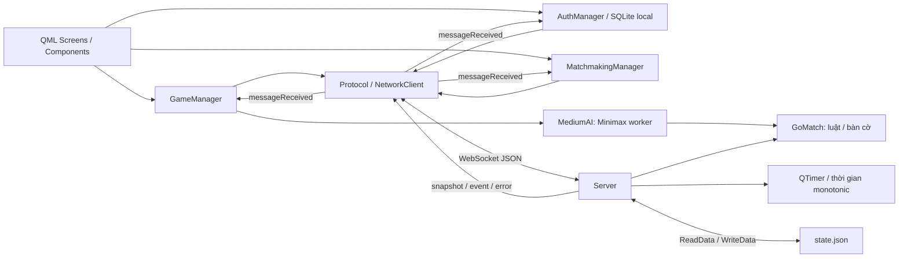
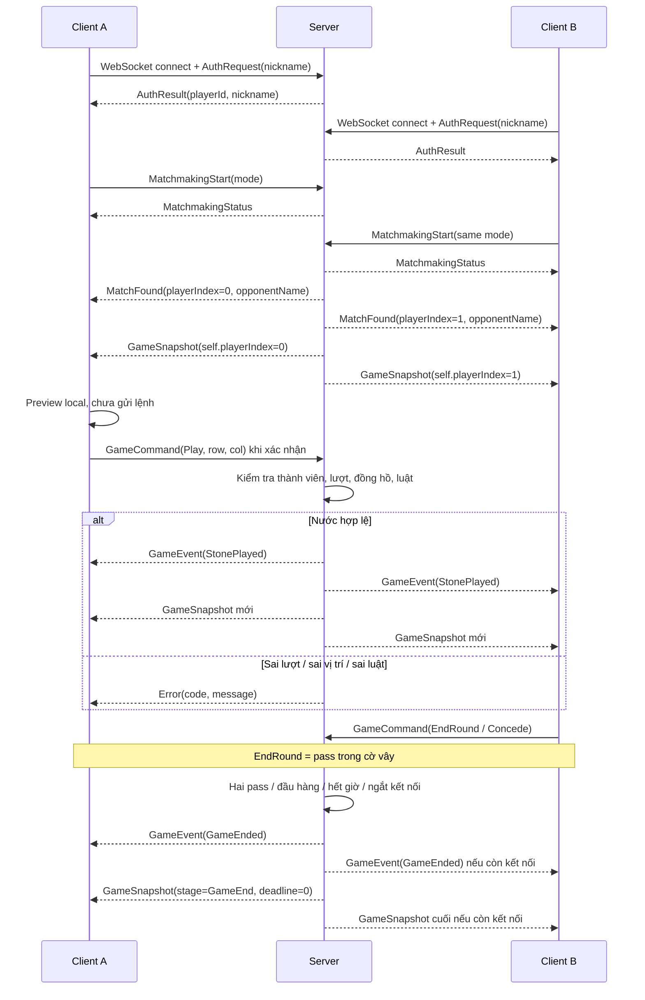

# GoGame

Game cờ vây C++/Qt 6: client Qt Quick/QML và server console WebSocket. Tài liệu cập nhật ngày **13/10/2026** sau khi dọn các thành phần không dùng. Client đã gửi lệnh online và áp dụng snapshot của server; hai người có thể ghép trận trên cùng máy. Server quyết định luật, lượt và đồng hồ Byo-yomi.

## Solo với AI từ menu chính

Chọn **Play against AI → Medium hoặc Hard** để bắt đầu ván offline: bạn cầm đen, AI cầm trắng. Không cần kết nối server; nút tạm khóa khi đang tìm trận online. Hard đã có bằng PUCT/MCTS; Easy hiện chưa khả dụng. Bản Medium dùng thuật toán Minimax/Alpha-Beta hiện có, chưa phải MCTS/RAVE hoặc mạng neuron.

AI tìm nước trong một worker riêng với ngân sách mặc định 1 giây, không chặn UI. Ván được tự lưu trong tối đa 20 slot; khi đầy, chọn slot và xác nhận ghi đè. **Load AI game** ở menu tiếp tục ván đã lưu; các nút Save/Load/Exit trong trận cũng hoạt động với AI.

Kiểm tra tính năng bằng `ctest --test-dir build/solo-ai --output-on-failure` sau khi configure/build tại `build/solo-ai` (bật `BUILD_TESTING`). Test `soloAI` dùng thư mục tạm, xác nhận AI trả lời, mở đầu khi người chơi cầm trắng, lưu/tải, hủy worker cũ và luồng menu offline tới bàn đấu bằng Qt offscreen.

## Chạy dự án

Cần CMake ≥ 3.16, compiler C++17 cho server và Qt 6 với Core, Gui, Quick/QML, Network, WebSockets, Sql. CMake khai báo Qt ≥ 6.2; client dùng `QWebSocket::errorOccurred`, nên kit Qt phải cung cấp signal này (kit cũ có thể cần điều chỉnh code).

Tại thư mục gốc, mở **terminal riêng cho server**:

```bash
cmake -S server -B build/server
cmake --build build/server --parallel 3
./build/server/appserver --data-file server/data/state.json
```

Tại thư mục gốc mở **terminal**:

```
./tools/run-katago-hard.sh
```

**Giữ terminal này chạy trong khi dùng client.** Server nghe `ws://127.0.0.1:14509`, dừng bằng `Ctrl+C`. Nếu CMake chưa tìm được Qt, thêm `-DCMAKE_PREFIX_PATH=/duong/dan/toi/Qt` khi configure. File chưa tồn tại được tạo bằng `{}`; file hỏng khiến server dừng và giữ nguyên dữ liệu.

Mở terminal khác cho client:

```bash
cmake -S . -B build/local
cmake --build build/local --parallel 3
GOGAME_SERVER_URL=ws://127.0.0.1:14509 ./build/local/appGoGame
```

Có thể mở `CMakeLists.txt` bằng Qt Creator. Root build cũng thêm target server bằng `add_subdirectory(server)`; không cần chạy thêm server nếu terminal server đã hoạt động. Client tự kết nối khi mở và bắt đầu ở LoginScreen. Mở hai instance client trong hai terminal, đăng ký/đăng nhập hai tài khoản local, chọn **Find Match** ở cả hai. Server ghép mode `Go`, client nhận màu và tên đối thủ rồi mở MatchScreen. Có thể đặt `--main-minutes 15` khi chạy server; mặc định là 10 phút. Settings hiện cho chọn background trong phiên.

## Kiến trúc và tương tác



Luồng dưới đây đã được nối qua NetworkClient, GameManager và MatchScreen. Preview giữ ở client; chỉ lần xác nhận mới gửi Play. Khi chờ phản hồi, client khóa thao tác để tránh gửi nước trùng.



Server là nguồn quyết định bàn cờ online, lượt và thời gian. Preview chỉ là UI; client cần chờ snapshot sau khi gửi lệnh xác nhận. Luồng `ReadData`/`WriteData` độc lập với trận đấu; hiện không dùng để đồng bộ hoặc tự lưu các match.

## Giao thức JSON và sendSnapshot

Mọi text message dùng envelope `{"type":"...","payload":{...}}`. Binary không được hỗ trợ; giới hạn message nhận 1 MiB.

| Client → server     | Payload                             | Server → client                                                                    |
| ------------------- | ----------------------------------- | ---------------------------------------------------------------------------------- |
| `AuthRequest`       | `nickname` (1–17 ký tự sau trim)    | `AuthResult` với `success`, `playerId`, `nickname`; nickname sai hiện trả `Error`. |
| `MatchmakingStart`  | `mode` (1–64 ký tự sau trim)        | `MatchmakingStatus`, sau đó `MatchFound` và snapshot khi đủ 2 người cùng mode.     |
| `MatchmakingCancel` | `{}`                                | `MatchmakingStatus`.                                                               |
| `GameCommand`       | `matchId`, `commandType`, `command` | `GameEvent` + snapshot, hoặc `Error`.                                              |
| `ReadData`          | `{}`                                | `Data` chứa `data`.                                                                |
| `WriteData`         | `data` là JSON object               | `DataWritten` với `ok: true`, hoặc `Error`. Thay toàn bộ file.                     |

Ví dụ đặt quân tại hàng 0, cột 0:

```json
{
    "type": "GameCommand",
    "payload": { "matchId": "<id từ MatchFound>", "commandType": "Play", "command": { "row": 0, "col": 0 } }
}
```

`Play` yêu cầu tọa độ nguyên 0–18; `EndRound` là pass và `Concede` là đầu hàng, cả hai dùng `command: {}`. Đầu hàng được phép ngoài lượt; đặt quân/pass chỉ được thực hiện đúng lượt. Các lệnh nhân vật, card, skill trong template không được server Go hỗ trợ.

`Server::sendSnapshot(socket, match)` tạo payload riêng cho mỗi người; overload `sendSnapshot(match)` gửi tới cả hai socket. Bàn cờ và thời gian công khai giống nhau, `self.playerIndex` theo người nhận.

| Trường snapshot                  | Ý nghĩa                                                                                                                  |
| -------------------------------- | ------------------------------------------------------------------------------------------------------------------------ |
| `matchId`, `stage`, `started`    | ID trận, `Action` khi chơi hoặc `GameEnd` khi kết thúc.                                                                  |
| `boardSize`, `board`             | 19 và mảng 361 ô theo `row * 19 + col`; `-1` trống, `0` đen, `1` trắng.                                                  |
| `moveCount`, `consecutivePasses` | Số lượt đã qua (kể cả pass), số pass liên tiếp.                                                                          |
| `currentPlayerIndex`, `komi`     | Người đến lượt; komi trắng 6,5.                                                                                          |
| `remainingMs`                    | Mảng thời gian đen/trắng tới ranh giới thời gian hiện tại (main hoặc một period Byo-yomi).                               |
| `clocks`                         | Mỗi người có `mainRemainingMs`, `periodRemainingMs`, `periodDurationMs`, `periodsRemaining`, `phase` (`Main`/`ByoYomi`). |
| `players`                        | Mỗi người có `playerId`, `nickname`, `playerIndex`, `color`, `remainingTimeMs`.                                          |
| `self.playerIndex`               | 0 hoặc 1; không có dữ liệu card/hand riêng.                                                                              |
| `serverTimeEpochMs`              | Thời điểm server tạo snapshot để client ước lượng lệch đồng hồ.                                                          |
| `actionDeadlineEpochMs`          | Epoch của ranh giới main/period hiện tại của người đang đi; bằng 0 khi trận kết thúc.                                    |
| `winnerIndex`, `endReason`       | `-1`/chuỗi rỗng khi đang chơi; người thắng và lý do khi kết thúc.                                                        |

Mỗi bên có **10 hoặc 15 phút chính + 3 lần Byo-yomi × 20 giây**. Hết main time chuyển sang Byo-yomi; hết một period mất một lần. Nước đi/pass hợp lệ hồi period hiện tại về 20 giây, không hồi số lần đã mất; lệnh sai không hồi giờ. Hết lần cuối xử thua. Server dùng monotonic time và QTimer kiểm tra tại ranh giới hoặc tối đa mỗi 30 giây; 30 giây không phải giới hạn mỗi nước. Snapshot gửi khi ghép trận, sau nước hợp lệ, timer và lúc kết thúc. GameClock nội suy clock của mình và đối thủ giữa các snapshot. Trường stage vẫn là chuỗi trong payload; không cần enum stage/card-game ở client.

## Trạng thái hiện tại và việc còn lại

| Phần          | Đã có                                                                                                                   | Còn thiếu                                                                                                            |
| ------------- | ----------------------------------------------------------------------------------------------------------------------- | -------------------------------------------------------------------------------------------------------------------- |
| Server        | Guest nickname, queue theo mode, nhiều trận riêng, luật cơ bản, xác nhận lượt/thành viên, timer và snapshot từng người. | Tài khoản server thật, TLS/phân quyền, khôi phục trận sau reconnect.                                                 |
| Client online | MatchFound, gửi Play/EndRound/Concede, chỉ áp dụng bàn/lượt sau snapshot, pending lock, lỗi và kết quả trận.            | Kiểm thử trực tiếp toàn bộ thao tác UI; hiện tên/avatar vẫn có giá trị mặc định khi chạy local.                      |
| Luật          | Ăn quân, tự sát, simple ko, hai pass tính đất + quân bắt theo công thức Nhật với komi 6,5.                              | Superko, xử lý/thỏa thuận quân chết, xác nhận quân chết/seki để hoàn thiện tính điểm Nhật.                           |
| Đồng hồ       | Byo-yomi do server quản lý, hiển thị clock hai bên, timer gửi snapshot.                                                 | Tùy chọn time control trong UI; hiện 10/15 phút chọn qua CLI.                                                        |
| Auth          | SQLite local, gửi guest nickname khi login và kết nối lại.                                                              | Server chưa xác thực password/tài khoản local; logout local không hủy danh tính guest trên server.                   |
| Settings      | Chọn background qua AppState trong phiên.                                                                               | Âm thanh, preview toggle có UI/lưu lựa chọn, avatar/frame/title/level/rank. Preview vẫn là property của MatchScreen. |
| Dữ liệu       | ReadData/WriteData nguyên tử bằng QSaveFile.                                                                            | Match chỉ ở RAM; chưa tự lưu match, replay 5 ván hoặc phục hồi sau restart. API file vẫn chưa phân quyền.            |
| AI / âm thanh | Có kế hoạch bên dưới và tài nguyên hình/font.                                                                           | Medium đã có trong `src/AI/`; Easy/Hard và nhạc/âm thanh đặt quân/báo lỗi chưa triển khai.                           |

## Những thay đổi trong lần dọn project này

Đối chiếu với working tree ngay trước tác vụ, **xóa 22 file không được luồng hiện tại sử dụng**, tổng **403 dòng / 13.997 ký tự**. Các thay đổi online/Byo-yomi đã có trước tác vụ được giữ nguyên.

- Bỏ Card, CharacterCard, SupportCard, ElementPointBar và CountdownClock cũ; giữ GameClock và PlayerPanel đang dùng.
- Bỏ Loading/Popup, GameIcon/GameImage, GameBackground và GamePanel ở layout. Login dùng duy nhất GamePanel trong controls, loại bỏ trùng tên.
- Bỏ Constants không có consumer, GamemodeScreen chưa nối vào navigation, các file AI/Board/UI/Enums.cpp rỗng hoặc chỉ chứa khung.
- Bỏ `server/main.qml` và bản test cũ `server/test/Intergration.cpp`; giữ đủ bốn test thực trong `server/tests/`.
- Gỡ file đã xóa khỏi CMake và import layout khỏi các màn hình; bỏ dependency Qt Multimedia vì không có code audio hiện tại, bỏ tìm Quick lặp và resource SQLite root không được đọc. Dữ liệu tài khoản ở AppDataLocation giữ nguyên.
- Bỏ object AssetManager khởi tạo thừa ở main (QML singleton tự quản lý), macro Debug không dùng, include Multimedia thừa và mapping font không có consumer. Typography vẫn dùng font hiện có.
- Bỏ SubmitDeck, GameEventType và GameStage của template; EnumUtils chỉ giữ hai chuyển enum → string đang dùng. Bỏ các parser enum/helper protocol không có consumer hoặc chỉ khai báo: ErrorPayload, SubmitDeck, ChooseActiveCharacter, SwitchCharacter, UseSkill, PlayCard, EndRound wrapper, hai helper JSON nội bộ.
- Matchmaking chỉ nhận `mode`, không còn `deckId`. Play helper chỉ nhận `matchId`, `row`, `col`. Cập nhật mọi caller và test Players theo API này.
- Bỏ GameManager `play()` không làm gì, `endRound()` wrapper không được gọi, getter board_state/opponentName và signal/stage state không có consumer. Giữ snapshot, interaction/board/turn notifications, pass_turn và submit đang dùng.
- Bỏ Server `stop`/`address` không có caller và selection timeout của template; destructor vẫn dừng timer/socket. Không đổi protocol snapshot của server.
- Dọn design token Motion/Radius/Spacing/Theme không được component hiện tại dùng; đổi chữ TCG ở menu thành GoGame và `deckError` thành `matchmakingError`. Bỏ nút AI chưa có hành động; kế hoạch AI vẫn giữ bên dưới.
- Bỏ tạo ba deck JSON khi đăng ký; ghi `{}` vào cột SQLite `decks` cũ để tương thích database có sẵn. Không xóa dữ liệu hay migrate schema trong tác vụ này.
- Thêm `scripts/server_stats.py` để tái đếm dòng/ký tự. Giữ ảnh/avatar/font hiện có làm tài nguyên dự án và kế hoạch customization.

Các file đã xóa:

- `qml/Components/cards/Card.qml`
- `qml/Components/cards/CharacterCard.qml`
- `qml/Components/cards/SupportCard.qml`
- `qml/Components/battle/ElementPointBar.qml`
- `qml/Components/battle/CountdownClock.qml`
- `qml/Components/common/Loading.qml`
- `qml/Components/common/Popup.qml`
- `qml/Components/controls/GameIcon.qml`
- `qml/Components/controls/GameImage.qml`
- `qml/Components/layout/GameBackground.qml`
- `qml/Components/layout/GamePanel.qml`
- `qml/Core/Constants.qml`
- `qml/Screens/GamemodeScreen.qml`
- `src/Core/AI.cpp`
- `src/Core/AI.h`
- `src/Core/Enums.cpp`
- `src/Models/Board.cpp`
- `src/Models/Board.h`
- `src/Models/UI.cpp`
- `src/Models/UI.h`
- `server/main.qml`
- `server/test/Intergration.cpp`

## Dòng và ký tự của server

Đếm **mã server hiện tại**, không suy đoán số ký tự do riêng chủ dự án gõ: lịch sử có thay đổi của người và AI, Git author không chứng minh tác giả của từng ký tự. Mỗi dòng vật lý tính bằng `splitlines()` (kể cả dòng trống/comment); ký tự tính Unicode code points sau decode UTF-8, gồm khoảng trắng và xuống dòng, không phải byte. Không tính README, JSON dữ liệu, client code, file build hoặc script thống kê.

| File / phạm vi              |      Dòng |      Ký tự |
| --------------------------- | --------: | ---------: |
| `server/main.cpp`           |        42 |      1,665 |
| `server/Server.h`           |        77 |      2,777 |
| `server/Server.cpp`         |       580 |     18,973 |
| `server/GoMatch.h`          |        20 |        428 |
| `server/GoMatch.cpp`        |        84 |      2,905 |
| `server/ByoYomiClock.h`     |        38 |      1,378 |
| **Runtime .cpp/.h**         |   **841** | **28,126** |
| Tests (4 file .cpp)         |       395 |     21,815 |
| server/CMakeLists.txt       |        41 |      1,983 |
| **Runtime + tests + CMake** | **1,277** | **51,924** |

Runtime trước dọn: 885 dòng / 29.272 ký tự; sau dọn giảm 44 dòng / 1.146 ký tự. Đây là chênh lệch đầu/cuối tác vụ, không so với HEAD (working tree đã có thay đổi trước đó).

Chạy lại thống kê khi server thay đổi:

```bash
python3 scripts/server_stats.py
```

## Cấu trúc file hiện tại

Toàn bộ file mã nguồn/tài nguyên và thư mục rỗng hiện có được liệt kê. `.git/`, `.qtcreator/`, `build/` thu gọn vì là dữ liệu Git/IDE hoặc file sinh khi build.

```text
GoGame/
├── .agents/
├── .aws/
├── .cache/
│   └── clangd/
│       └── index/
│           ├── .gitignore
│           ├── AI.cpp.4E17C31F7974B5FF.idx
│           ├── AssetManager.h.AD84910C2506BD0F.idx
│           ├── AuthManager.cpp.4E081B7E22E49ED9.idx
│           ├── AuthManager.h.355273112F6E7ADA.idx
│           ├── Board.cpp.EE2C4218E85A5C17.idx
│           ├── Enums.h.DA031E0D910F3FFB.idx
│           ├── Enumutils.cpp.3B1DA0BA1C8CF8BD.idx
│           ├── Enumutils.h.F79FE42F007ACA52.idx
│           ├── Game.cpp.A55E6ED5908CF8C8.idx
│           ├── Game.h.290119D6A4FD0010.idx
│           ├── GoMatch.h.B601810E97098950.idx
│           ├── Integration.cpp.500A2BFCCE88B845.idx
│           ├── MatchmakingManager.cpp.FFB6A3A0C05AB22C.idx
│           ├── MatchmakingManager.h.20A7300CFB34F87D.idx
│           ├── NetworkClient.cpp.581BAFBC786E9B0E.idx
│           ├── NetworkClient.h.9D3C13B4CBC6DD91.idx
│           ├── Protocol.cpp.1408598CB1820C84.idx
│           ├── Protocol.h.1FC09BF6E61449A2.idx
│           ├── Server.cpp.DD6C1D482EAE20BF.idx
│           ├── Server.h.DC4431FD042675DE.idx
│           ├── UI.cpp.8D0D7D51C00009F2.idx
│           ├── main.cpp.09E654D3744D22E9.idx
│           └── main.cpp.65773C1C417C5788.idx
├── .codex/
├── .git/ [thu gọn: Git/IDE/file build]
├── .qtcreator/ [thu gọn: Git/IDE/file build]
├── assets/
│   ├── background/
│   │   ├── background1.png
│   │   ├── background2.png
│   │   └── background3.png
│   ├── fonts/
│   │   └── genshin.ttf
│   ├── playerAvatar/
│   │   ├── ayame1.png
│   │   ├── ayame2.png
│   │   ├── ayame3.png
│   │   ├── ayame4.png
│   │   ├── ayame5.png
│   │   ├── ayame6.png
│   │   ├── ayame8.webp
│   │   ├── eula (5).png
│   │   ├── hutao (1).jpeg
│   │   ├── hutao (1).png
│   │   ├── hutao (11).png
│   │   ├── hutao (12).png
│   │   ├── hutao (3).png
│   │   ├── kazuha (3).png
│   │   ├── kazuha (4).png
│   │   ├── kazuha (5).png
│   │   ├── nahida.jpg
│   │   ├── paimon (1).jpg
│   │   ├── yoimiya (1).png
│   │   ├── yoimiya (4).png
│   │   └── yoimiya (8).png
│   ├── sounds/
│   └── stones/
├── build/ [thu gọn: Git/IDE/file build]
├── qml/
│   ├── Components/
│   │   ├── battle/
│   │   │   ├── GameClock.qml
│   │   │   └── PlayerPanel.qml
│   │   └── controls/
│   │       ├── GameButton.qml
│   │       ├── GamePanel.qml
│   │       └── GameText.qml
│   ├── Core/
│   │   ├── Motion.qml
│   │   ├── Radius.qml
│   │   ├── SceneManager.qml
│   │   ├── Spacing.qml
│   │   ├── Theme.qml
│   │   └── Typography.qml
│   ├── Screens/
│   │   ├── LoginScreen.qml
│   │   ├── MainMenu.qml
│   │   ├── MatchScreen.qml
│   │   └── SettingsScreen.qml
│   ├── Singletons/
│   │   └── AppState.qml
│   └── Themes/
├── scripts/
│   └── server_stats.py
├── server/
│   ├── data/
│   │   └── state.json
│   ├── ByoYomiClock.h
│   ├── CMakeLists.txt
│   ├── GoMatch.cpp
│   ├── GoMatch.h
│   ├── README.md
│   ├── Server.cpp
│   ├── Server.h
│   └── main.cpp
├── src/
│   ├── Core/
│   │   ├── Enums.h
│   │   ├── Enumutils.cpp
│   │   ├── Enumutils.h
│   │   ├── Game.cpp
│   │   └── Game.h
│   ├── Data/
│   ├── Managers/
│   │   ├── AssetManager.cpp
│   │   ├── AssetManager.h
│   │   ├── AuthManager.cpp
│   │   ├── AuthManager.h
│   │   ├── MatchmakingManager.cpp
│   │   └── MatchmakingManager.h
│   └── Network/
│       ├── NetworkClient.cpp
│       ├── NetworkClient.h
│       ├── Protocol.cpp
│       └── Protocol.h
├── .gitignore
├── CMakeLists.txt
├── README.md
├── main.cpp
├── main.qml
└── users.sqlite
```

`server/Server.*` quản lý kết nối/queue/match; `GoMatch.*` chứa luật; `ByoYomiClock.h` chứa time control. `src/` là client, `qml/` là UI; `scripts/` chứa script đo source. Các thư mục tài nguyên trống được giữ cho kế hoạch âm thanh/quân cờ.

Các file test, executable test và cấu hình CTest đã được xóa khỏi dự án. Build chỉ tạo client, server và các thư viện runtime.

## Kế hoạch phát triển

### 1. Hoàn thiện MatchScreen.qml trước

- [ ] Ưu tiên `qml/Screens/MatchScreen.qml`.
- [x] Hoàn thiện UI bàn đấu: ô hiện tên người chơi và avatar.
- [x] Hoàn thành logic đồng hồ đếm ngược phía client.
- [x] Server quản lý thời gian mỗi người chơi và gửi deadline trong snapshot.
- [x] Nối snapshot và đồng hồ server vào UI client bằng GameClock.
- [x] Hiển thị đồng hồ của đối thủ.
- [ ] Cân nhắc thu nhỏ layout bàn cờ để có thêm không gian cho chế độ chơi; đây là ý tưởng có thể làm sau.

### 2. Đặt quân bằng hai lần nhấn

- [x] Lần đầu tại vị trí hợp lệ: chỉ hiện quân cờ mờ, nhấp nháy (preview).
- [x] Lần thứ hai tại cùng vị trí: xác nhận đặt quân.
- [ ] Cho phép bật/tắt chế độ này trong settings.

### 3. Phản hồi khi đặt sai vị trí

- [x] Hiện chữ báo lỗi ở trên cùng màn hình.
- [x] Không cho đặt quân, kể cả preview, ở vị trí không hợp lệ.
- [ ] Phát âm thanh báo lỗi — phần còn thiếu duy nhất của phản hồi vị trí sai.

### 4. Luật Trung / Nhật

- [x] Server có luật cơ bản: ăn quân, tự sát, simple ko, hai lần pass và tính đất + quân bắt với komi 6,5.
- [ ] Hoàn thiện luật Trung: superko, xử lý quân chết/thỏa thuận kết quả và kiểm thử tính điểm.
- [ ] Cân nhắc luật Nhật sau vì triển khai phức tạp; chưa ưu tiên.

### 5. Animation khi ăn quân

- [ ] Thêm animation ăn quân ở giai đoạn sau vì khá phức tạp.

### 6. Tài nguyên âm thanh

- [x] Tìm nhạc game.
- [x] Tìm âm thanh đặt quân.
- [ ] Tìm âm thanh báo lỗi.

### 7. Settings trong trận

- [x] Cho phép tùy chỉnh âm thanh.
- [ ] Cho phép bật/tắt chế độ preview.

### 8. Settings ngoài trận

- [ ] Đổi giao diện bàn đấu, avatar, khung avatar và danh hiệu.
- [ ] Có tùy chỉnh level và rank theo yêu cầu; cơ chế cụ thể sẽ xác định khi triển khai.
- [x] Bao gồm mọi tùy chỉnh của settings trong trận.

### 9. Đấu với người qua JSON

- [x] Server gửi JSON snapshot chứa bàn cờ, số nước, lượt và thời gian.
- [x] Client áp dụng snapshot và gửi lệnh thay cho thay đổi bàn cờ local.
- [ ] Lưu trạng thái trận/replay riêng; hiện trận chỉ nằm trong bộ nhớ, file JSON chưa lưu trận tự động.

### 10. Xem lại ván đấu

- [ ] Lưu tối đa 5 ván gần nhất bằng JSON chứa các nước đã đi.
- [ ] Cho phép xem lại diễn biến ván đấu.
- [ ] Đánh giá nước đi làm sau vì cần AI.

### 11. AI đấu với máy

| Độ khó     | Dự định                                                                               |
| ---------- | ------------------------------------------------------------------------------------- |
| Dễ         | Minimax suy nghĩ nông, tính trước 1–2 nước.                                           |
| Trung bình | Đã có Minimax trong `src/AI/`: depth tối đa 3, 10 ứng viên/nút, ngân sách 1 giây.     |
| Khó        | Alpha-Beta Pruning kết hợp MCTS để tối ưu; hướng tới dùng mạng 6-block ONNX trên CPU. |

Medium được tách thành module riêng tại [src/AI/README.md](src/AI/README.md). Chọn **Play against AI → Medium** để chơi offline. Luồng: nước người chơi → luật GoMatch → worker Minimax → áp nước AI trên GUI. Dùng một worker, có hủy khi rời/reset ván và giữ chế độ preview/Fast mode. Sau tối ưu DSU/vùng ứng viên: bàn trống hoàn thành depth 3, 586 nodes, khoảng 61 ms; độ sâu và thời gian thực tế tùy vị trí. Easy/Hard chưa triển khai, đồng hồ Byo-yomi hiện chỉ có trong trận online.

- [ ] Đo số phép tính và thời gian trên máy thực tế để mỗi nước AI không tốn quá 1–2 giây.
- [ ] Giới hạn song song tối đa 3 luồng CPU. Ý tưởng ban đầu dùng `ParallelOptions { MaxDegreeOfParallelism = 3 }`; đây là cú pháp C#, khi triển khai trong dự án C++/Qt cần cơ chế tương đương.
- [ ] MCTS giới hạn tối đa 1000 playouts và dừng khi hết ngân sách thời gian.
- [ ] Lớp bảo vệ Alpha-Beta nông ở depth 1 quét các tình huống nguy cấp như Atari, cứu quân; mục tiêu quét khoảng 1 ms cần được đo kiểm.
- [ ] Nếu có nước nguy cấp, trả về nước xử lý ngay; nếu thế trận hòa hoãn, chạy MCTS.
- [ ] Mạng 6-block `.onnx` chạy CPU: policy gợi ý 3–5 nước tốt nhất, value chấm điểm thế trận.

Luồng ý tưởng ban đầu:

```text
[ Người chơi đi 1 nước ]
             |
             v
[ Lớp bảo vệ: Alpha-Beta cắt tỉa nông (Depth 1) ]
[ Quét nhanh: Atari, cứu quân — mục tiêu 1 ms ]
             |
       +-----+--------------------+
       |                          |
Có nước nguy cấp          Thế trận hòa hoãn
       |                          |
       v                          v
[ AI đi luôn ]           [ Bộ não chính: MCTS ]
                         [ Tối đa 3 luồng CPU ]
                         [ Tối đa 1000 playouts ]
                                  |
                                  v
                         [ Mạng 6-block ONNX / CPU ]
                         [ Policy: gợi ý 3–5 nước ]
                         [ Value: chấm điểm thế trận ]
                                  |
                                  v
                         [ Trả về nước đi tối ưu ]
```

“Mát máy, 0% CPU” trong ý tưởng gốc là mong muốn giảm tải khi chọn được nước ngay; xử lý thực tế vẫn sử dụng CPU. Các mốc 1 ms, 1–2 giây, 3 luồng và 1000 playouts là mục tiêu/giới hạn thiết kế cần thử nghiệm, chưa phải kết quả benchmark.

### 12. Build mạng neuron 6b =)))

- [ ] Xây dựng và huấn luyện mạng neuron 6-block.
- [ ] Xuất mô hình `.onnx` để phục vụ policy/value trong AI.
- [ ] Thử nghiệm tốc độ suy luận CPU cùng ngân sách thời gian của MCTS.

## Chế độ mô phỏng và lưu ván AI

Chọn **Sandbox** trong menu để điều khiển cả đen và trắng theo lượt, không xoay bàn. Trong trận có Reset, Undo, Redo, Save, Load và Exit. Sandbox chỉ lưu một bản `sandbox.json`; Reset không xóa bản Save, Exit không tự ghi đè bản sandbox đã lưu.

Trận Medium có **10 lần Undo và 10 lần Redo** (đổi `GameManager::AIHistoryLimit` trong `src/Core/Game.h`). Undo lùi cả cặp nước người chơi–AI; đi nhánh mới xóa Redo cũ. Có tối đa **20 slot JSON**. Slot đang chơi được auto-save sau mỗi nước và khi thoát; menu **Load AI battle** khôi phục đúng lượt, kể cả AI đang chờ đi. Khi đầy, chọn slot ghi đè để tạo ván mới.

Engine GoMatch dùng DSU chung cho client, server, AI và tính vùng trống; AI đọc cache nhóm/khí, dùng Minimax có Alpha-Beta và vùng ứng viên cục bộ. Điều phối AI tách tại `src/AI/AIGame.cpp`. Phép đo bàn trống sau tối ưu: depth 3 / 586 nodes / khoảng 61 ms, trong khi phép đo trước hoàn thành depth 2 ở 1000 ms; vùng ứng viên nay được giới hạn nên không phải so sánh trên cùng cây tìm kiếm. Trần 1 giây vẫn giữ cho thế khó.

Thông báo trong trận gồm ăn quân, ko/tái bắt bị cấm, phản ứng ko gây atari và điểm khi hai bên pass. JSON lưu lịch sử, cursor, bàn hiện tại/trước đó, ko, lượt, số nước, quota và kết quả. Load kiểm tra/replay dữ liệu trước khi thay trạng thái. Chi tiết vị trí file, cấu trúc và giới hạn luật: [src/AI/README.md](src/AI/README.md).

## Tách client AI, DataManager và huấn luyện SGF

AI nằm hoàn toàn trong `src/AI/`, chỉ được build ở client. Luật DSU chung chuyển sang `src/Rules/`; client và server cùng biên dịch source luật, server không build AI hoặc phụ thuộc Qt Concurrent. AI, DataManager và luật được khai báo trực tiếp trong CMake gốc của client; chỉ server có CMake riêng. Phần JSON save/load/slots/replay được tách khỏi GameManager sang `src/Managers/DataManager.h/.cpp`, giữ nguyên API nút lưu/tải.

File `src/AI/trainAI.py` có inspect/prepare SGF, huấn luyện Transformer ~6 tỷ tham số (5.974.470.659; policy 362 + value), resume checkpoint và export ONNX external data. Cấu hình `resnet6` dùng để thử pipeline nhỏ. Chưa có trọng số 6B đã train vì chưa có corpus SGF thật. Pipeline train/resume/export đã được kiểm tra bằng model nhỏ trong venv tạm; cấu hình 6B được đếm tham số trên meta device. Hướng dẫn để tự triển khai Minimax, Alpha-Beta, MCTS và đọc neuron: [src/AI/IMPLEMENTATION_GUIDE.md](src/AI/IMPLEMENTATION_GUIDE.md).

## Khai báo AI và nhật ký prompt

README này được soạn với sự hỗ trợ của AI (Codex) theo yêu cầu của chủ dự án. Lần cập nhật này chỉ tạo tài liệu, không triển khai các tính năng trong kế hoạch.

### Phạm vi lịch sử và quy ước cập nhật

Chỉ có prompt liên quan dự án đang hiện diện trong cuộc trò chuyện này để ghi lại. Không có nội dung các prompt ở những phiên trước nên chưa thể khẳng định đây là toàn bộ lịch sử dự án; không suy đoán hoặc tự dựng lại prompt cũ từ mã nguồn.

Theo yêu cầu của chủ dự án, từ đây mỗi lần AI xử lý prompt mới liên quan GoGame phải bổ sung **nguyên nội dung prompt**, ngày và kết quả thực hiện vào mục này, giữ nguyên các mục cũ. Prompt cũ được cung cấp thêm cũng phải được bổ sung, ghi rõ ngày nếu biết. Đây là quy ước cần thực hiện trong các lần làm việc tiếp theo, không phải cơ chế tự động thu thập các cuộc trò chuyện ngoài quyền truy cập.

### 12/10/2026 — Yêu cầu tạo README.md

Nội dung prompt của người dùng (chuẩn hóa khoảng trắng và xuống dòng từ định dạng tin nhắn):

```text
Viết README.md với những yêu cầu sau:

1. Đầy đủ cấu trục file hiện tại
2. Những dự định trong tương lai:
   1. Cần làm phần Board.qml trước, hoàn thiện UI gồm: Phần ô hiện tên người chơi, avatar, đồng hồ đếm ngược,
   2. Đặt quân cần ấn liên tiếp 2 lần, cụ thể ấn lần đầu chỉ hiện quân cờ mờ, nhấp nháy, ấn lần 2 để xác nhận đặt quân. Có thể bật tắt tùy chỉnh này trong settings.
   3. Tại các ô đặt vị trí sai sẽ báo lỗi bằng cách hiện chữ ở trên cùng màn hình, không cho đặt kể cả preview, khoanh đỏ ô đặt lỗi trong 0,5-1 giây(comment lại đoạn này để dễ fix), âm thanh báo lỗi.
   4. Luật Trung/Nhật(có thể sẽ làm nhưng rất phiền nên để làm luật Trung trước.
   5. Animation khi ăn quân (khá phiền nên để sau).
   6. Tìm tài nguyên nhạc game, âm thanh đặt quân.
   7. Trong phần setting trong trận, cho phép tùy chỉnh âm thanh, tắt mở chế độ preview.
   8. Trong phần setting ngoài trận, cho phép đổi giao diện bàn đấu, avatar, khung của avatar, danh hiệu, level, rank. Và mọi setting trong trận.
   9. Chế độ đấu với người hãy thực hiện qua JSON sẽ lưu: sân đấu hiện tại, số bước đã qua, người đi lượt hiện tại, thời gian.
   10. Chế độ xem lại ván đấu: lưu nhiều nhất 5 ván gần nhất lưu json các nước đã đi. Đánh giá nước đi (Tính năng làm sau do cần AI).
   11. AI độ khó của chế độ đấu với máy: Dễ(Suy nghĩ nông tính trước 1-2 nước dùng MinMax, Trung bình dùng MinMax, Khó Alpha-Beta Prune + MCTS để tối ưu (test trước số lượng phép tính cần sao cho các bước không tốn quá 1-2 giây) (giới hạn cpu nếu k cháy máy ParallelOptions { MaxDegreeOfParallelism = 3 }) ý tưởng chính là:

 [ Người chơi đi 1 nước ]
                          │
                          ▼
    [ Lớp Bảo Vệ: Alpha-Beta Cắt Tỉa Nông (Depth 1) ]
    (Quét nhanh 1ms các nước nguy cấp: Atari, Cứu quân)
                          │
            ┌─────────────┴─────────────┐
   Có nước nguy cấp             Thế trận hòa hoãn
            │                           │
            ▼                           ▼
      [ AI ĐI LUÔN ]             [ Bộ não chính: MCTS ]
   (Mát máy, 0% CPU)      ┌─────────────┴─────────────┐
                          │   Khóa cứng: 3 Luồng CPU  │
                          │   Khóa cứng: 1000 Playouts│
                          └─────────────┬─────────────┘
                                        ▼
                    [ Dùng Mạng 6-Block (.onnx) trên CPU ]
                    - Gợi ý 3-5 nước tốt nhất (Policy)
                    - Chấm điểm thế trận lập tức (Value)
                                        │
                                        ▼
                           [ Trả về nước đi tối ưu ]

12. Build cái mạng neuron 6b =)))

Tài liệu tham khảo:
1. https://www.studocu.vn/vn/document/dai-hoc-dien-luc/dien-luc-university/bao-cao-nhap-mon-tri-tue-nhan-tao/88382780?sid=a353be05-df77-4401-bae7-4597fba4fd601791775595
2. https://www.scribd.com/document/434712509/BAO-CAO (Cờ Caro nhưng để tham khảo về phương trình khá tốt)
3. https://www.moderndescartes.com/essays/implementing_go/ (Không phải cách xây dựng tối ưu nhưng ổn)
4. https://www.codingame.com/ide/puzzle/atari-go (thử độ mạnh thuật toán
)
5. https://github.com/HosseinBakand/GO-Game-Min-Max-/tree/main/BaseGo/core (tham khảo minimax)
6. https://github.com/GTnull/Go/blob/master/version_2.0/src/gogame/monteCarloMethod.java (như trên)
7. https://github.com/27rg5/AI-bot-for-GO-game (Q-learning algorithm tham khảo trên bàn cờ 5x5)
8. https://durhamgo.club/GoByGo.pdf (Tài liệu tham khảo)
9. https://deepmind-media.storage.googleapis.com/alphago/AlphaGoNaturePaper.pdf (Tài liệu tham khảo)
10. SplitMix64 là một thuật toán sinh số giả ngẫu nhiên (PRNG) 64-bit tốc độ cao và dung lượng bộ nhớ siêu nhỏ. Thuật toán này ban đầu được thiết kế bởi Guy L. Steele Jr., Doug Lea và Christine H. Flood vào năm 2014 như một phần của thư viện Java 8 (SplittableRandom), sau đó được Sebastiano Vigna chuẩn hóa và đưa vào sử dụng rộng rãi trong thế giới C/C++.
Điểm đặc biệt của SplitMix64 là nó có thể tách (split) một trình sinh số ngẫu nhiên thành nhiều trình sinh độc lập hoạt động song song mà không sợ bị trùng lặp chuỗi kết quả.
3) Khai báo AI: Hãy viết tất cả những gì tôi đã prompt cho bạn của dự án này kể cả10 hiện tại và sau này vô đây
```

Kết quả: tạo README.md với cấu trúc hiện tại, đủ 12 mục kế hoạch và nhật ký prompt này. Đối chiếu cây mã nguồn/tài nguyên với hệ thống file; không chạy build hoặc test vì chỉ thay đổi tài liệu.

### 12/10/2026 — Cập nhật README về server và component template

Nội dung prompt của người dùng (chuẩn hóa xuống dòng):

```text
Viết readme.md:

1. Tạo xong server sơ khai, chạy được json
2. Fix 1 số component gây lỗi do template
3. Thêm hướng dẫn sử dụng server như sau: Mở 1 terminal riêg chạy "cmake -S server -B build/server
   cmake --build build/server --parallel 3
   ./build/server/appserver --data-file server/data/state.json" và để yên đó còn lại là client.
4. Cập nhật trạng thái của server: đã có, thiếu những gì.
```

Kết quả: cập nhật README.md hiện có, bổ sung server vào cây thư mục, ghi nhận server JSON sơ khai và các lỗi template đã sửa; thêm hướng dẫn giữ server chạy trong terminal riêng và mở client riêng. Đối chiếu mã server/client để liệt kê phần đã có và còn thiếu, bao gồm tham chiếu `deckManager` còn sót. Lần này chỉ chỉnh tài liệu; không sửa component, không chạy build hoặc test lại.

### 12/10/2026 — Resolve GitHub push conflict

Nội dung prompt của người dùng:

```text
relovse confict of github push
```

Kết quả: hợp nhất `origin/main` vào `main`, giữ lịch sử hai nhánh và sửa conflict trong `server/main.cpp`, `src/Network/NetworkClient.cpp`. Hai phiên bản chỉ khác định dạng khoảng trắng; giữ định dạng local, nhận các thay đổi remote về cấu hình build, tài liệu và test.

Kiểm tra merge: build client `build/Desktop_Debug` và build server sạch `build/merge-check-server` thành công; CTest integration đạt 1/1. Build server trong thư mục cũ gặp cache AUTOMOC lỗi thời; build sạch xác nhận mã hợp nhất hoạt động.

### 12/10/2026 — Implement `gameManager.pass_turn`

Nội dung prompt của người dùng:

```text
implement gameManager.pass_turn
```

Kết quả: thêm `Q_INVOKABLE void Game::pass_turn()` để QML có thể gọi `gameManager.pass_turn()`. Hàm chuyển lượt sang người chơi còn lại, xóa hạn chế ko ngay lập tức vì một lượt bỏ qua đã diễn ra, và phát `currentPlayerChanged` để giao diện cập nhật. Không thay đổi trạng thái bàn cờ. Build client được kiểm tra bằng `cmake --build build/local --parallel 3` và hoàn tất thành công.

### 12/10/2026 — Append AI prompt log to README

Nội dung prompt của người dùng:

```text
and append to the README.md, follow the AI guidelines
```

Kết quả: bổ sung đầy đủ hai prompt của phiên làm việc này, ngày thực hiện và kết quả vào nhật ký AI trong README.md theo quy ước của dự án.

### 12/10/2026 — Cập nhật tiến độ đồng hồ, báo lỗi và layout bàn cờ

Nội dung prompt của người dùng:

```text
Cập nhật README. Đồng thời note những thứ này để sau này tôi làm:

1. Phần đồng hồ đếm ngược đã xong logic nhưng cần handle từ server và có thể thêm đồng hồ của đối thủ -> đã đến bước làm server.
2. Phần báo lỗi vị trí đã xong hết bỏ đi đoạn khoang đỏ đi giờ chỉ thiếu âm thanh báo lỗi.
3. Layout bàn cờ nhỏ hơn(có thể sẽ làm để thêm chế độ chơi).
```

Kết quả: cập nhật tiến độ theo thông tin chủ dự án cung cấp. Đánh dấu logic đồng hồ client đã xong, ghi việc xử lý thời gian ở server là bước tiếp theo và khả năng thêm đồng hồ đối thủ. Đánh dấu phản hồi vị trí sai đã xong, bỏ yêu cầu khoanh đỏ khỏi kế hoạch hiện hành, chỉ giữ âm thanh báo lỗi là việc còn thiếu. Ghi ý tưởng thu nhỏ layout bàn cờ để thêm chế độ chơi. Giữ nguyên prompt lịch sử; chỉ sửa README, không thay đổi mã nguồn hoặc chạy build/test.

### 13/10/2026 — Review toàn dự án, sơ đồ tương tác và sendSnapshot

Nội dung prompt của người dùng (bỏ markup nhấn mạnh, chuẩn hóa khoảng trắng):

```text
Review all project, draw the interaction which will have between server and client. Rewrite readme.md. I sketch the sendSnapshot of server you should complete it: sendSnapshot(socket, match) {
        const localIndex = match.sockets.indexOf(socket);
        this.send(socket, "GameSnapshot", {
            matchId: match.id,
            stage: "Action",
            round: match.round,
            currentPlayerIndex: match.currentPlayerIndex,
            pendingReplacement: match.pendingReplacement || null,
            weather: {
                sequence: match.weather.sequence,
                activeWeather: {
                    type: match.weather.rounds[match.round - 1] ?? "None",
                    startedRound: match.round,
                    remainingRounds: 1,
                },
                roundsPerWeather: 1,
            },
            players: match.players.map((state, index) => {
                const player = this.clients.get(match.sockets[index]);
                return {
                    playerId: player.id,
                    nickname: player.nickname,
                    characters: state.characters.map((character, characterIndex) => ({
                        ...character,
                        element: character.applications[0] ?? "None",
                        active: characterIndex === state.activeCharacterIndex,
                        defeated: character.hp <= 0,
                    })),
                    elementPoints: { current: state.elementPoints, maximum: 10, permanentBonus: 0 },
                    handCardCount: state.hand.length,
                    deckCardCount: state.deck.length,
                    activeCharacterIndex: state.activeCharacterIndex,
                    summons: state.summons.map(publicEffect),
                    states: state.states.filter(item => !item.passive).map(publicEffect),
                    skillAvailability: availability(state, match),
                    switchesUsed: state.switchesUsed || 0,
                    switchesRemaining: Math.max(0, 1 - (state.switchesUsed || 0)),
                    remainingTimeMs: state.remainingMs,
                    endedRound: match.ended.has(index),
                };
            }),
            self: {
                handCardIds: localIndex >= 0 ? match.players[localIndex].hand : [],
                handAvailability: localIndex >= 0 ? handAvailability(match.players[localIndex], match) : [],
            },
            actionDeadlineEpochMs: match.actionDeadlineEpochMs,
        });
    }
```

Kết quả: review kiến trúc client/server, giao thức, luật, clock, auth, matchmaking, QML, tài nguyên, cấu hình build và test; viết lại README với cây file hiện tại, Mermaid kiến trúc/sequence, schema snapshot và các vấn đề tích hợp. Giữ kế hoạch và prompt lịch sử. Hoàn thiện `sendSnapshot(socket, match)` bằng C++ theo mô hình Go hiện có: trạng thái bàn cờ, player identity/color/time, góc nhìn self, stage, thời điểm server/deadline, kết quả cuối; không tạo giả các trường weather/card/character chưa tồn tại. Đóng băng clock lúc kết thúc. Giữ các thay đổi server đang có trong working tree.

Kiểm tra: build server sạch `build/review-server`, CTest đạt 2/2 (`goCommands`, `serverIntegration`); test snapshot mới xác nhận perspective, identities, board metadata, clock/deadline và trạng thái cuối. Build client sạch `build/review-client` thành công; còn cảnh báo Qt policy và file khung rỗng. Kiểm tra runtime offscreen được ghi bổ sung sau khi chạy; chưa kiểm tra thao tác online bằng UI.

Runtime smoke: client offscreen chạy trong 3 giây và bị dừng bằng timeout (exit 124), không có output được ghi nhận; kiểm tra này chưa xác nhận các binding QML hoặc tương tác UI hoạt động. Các vấn đề UI nêu trên được xác định từ review mã nguồn.

### 13/10/2026 — Dọn thành phần không dùng và thống kê server

Nội dung prompt của người dùng:

```text
Remove unused element, component, function in the project. Rewrite README.md which contains all changes count how many character and lines I wrote for this server.
```

Kết quả: xóa 22 file không dùng; dọn API, enum, signal, helper, design token, import và cấu hình build; giữ online/Byo-yomi đang phát triển, tài nguyên và dữ liệu tài khoản. Viết lại trạng thái README, ghi đầy đủ nhóm thay đổi, cây file, kế hoạch còn lại và bảng đo server. Runtime hiện 841 dòng/28.126 ký tự; gồm tests và CMake là 1.277 dòng/51.924 ký tự. Không gán toàn bộ số liệu này cho riêng tác giả người dùng; thêm script tái đếm. Root build và bốn test đạt; kiểm tra build server riêng/runtime UI được ghi bổ sung sau khi hoàn tất.

Kiểm tra bổ sung: build server riêng `build/cleanup-server` thành công. Client offscreen chạy 5 giây rồi được dừng bằng timeout (exit 124), không có output; đây chỉ là smoke attempt, chưa xác nhận thao tác/render UI. Không commit hoặc push trong tác vụ cleanup.

### 14/10/2026 — Phân tích tài liệu GoByGo và đặt câu hỏi

Nội dung prompt của người dùng:

```text
https://durhamgo.club/GoByGo.pdf
phân tích bài viết sau, chỉ ra các ý chính. Sau đó đưa ra 10-20 câu hỏi bạn không hiểu để tôi trả lời.
```

Kết quả: đọc tài liệu, phân tích các ý chính và chuẩn bị 15 câu hỏi về các điểm phương pháp chưa rõ cùng các lựa chọn áp dụng cho AI GoGame. Chờ chủ dự án trả lời; chưa triển khai AI hoặc thay đổi mã nguồn.

### 14/10/2026 — So sánh MCTS + RAVE với thiết kế AI hiện tại

Nội dung prompt của người dùng:

```text
Qua tài liệu tôi nhận thấy MCTS + RAVE là phương án tốt. So sánh nó với phương án hiện tại của tôi. Nếu có thể kết hợp cả 2 thì kết quả có tốt hơn không liệu mạng neuron có cần cần thiết hay có thể thu nhỏ không. Liệu có thể tối ưu hiệu năng trên cả máy tính cấu hình thấp?
```

Kết quả: đối chiếu thiết kế Alpha-Beta nông + MCTS + mạng 6-block với hướng MCTS/RAVE; kiểm tra nghiên cứu MC-RAVE, neural MCTS và tài liệu ONNX Runtime về threading/quantization. Đề xuất thử baseline không mạng trước, tactical search cục bộ hỗ trợ xếp hạng, rồi đo phương án mạng nhỏ nếu cần; chưa chốt thay đổi roadmap hoặc triển khai AI. Chất lượng và tốc độ cần benchmark với cùng thời gian trên máy mục tiêu.

### 14/10/2026 — Resolve merge conflict

Nội dung prompt của người dùng:

```text
Read the git error and resolve the conflict
```

Kết quả: kiểm tra merge đang dở giữa main và origin/main. Ba file còn unmerged đã có nội dung giải quyết trong working tree: giữ Game.cpp theo logic local hiện có (khác local commit chỉ định dạng khoảng trắng), giữ AssetManager.cpp/.h với currentStoneSkin từ remote. Giữ assets/settings được merge tự động; dọn khoảng trắng cuối dòng trong SettingsScreen. Đánh dấu ba file resolved và hoàn tất merge bằng commit, không force-push.

Kiểm tra: không còn conflict marker trong mã nguồn. Configure client bị chặn bởi src/AI/AIGame.cpp không tồn tại; MediumAI.cpp/.h và src/AI/README.md cũng được cấu hình nhưng chưa có trong working tree hoặc HEAD. Đây là vấn đề có sẵn, không khôi phục bằng cách thay logic AI mới bằng bản game cũ. Build server riêng được kiểm tra; kết quả ghi bên dưới.

Kiểm tra bổ sung: phát hiện Server.h đang lấy GoMatch.h cũ ở server/ thay vì implementation chung mà CMake build ở src/Rules/. Sửa include thành ../src/Rules/GoMatch.h, giữ logic scoring/ko mới của server. Đây là sửa tương thích build cần thiết; client vẫn cần bổ sung các file AI bị thiếu có sẵn từ local HEAD.

Kết quả build server riêng: thành công tại build/merge-server-20261014. Kiểm tra git diff --check đạt.

### 15/10/2026 — Thêm solo AI vào MainMenu.qml

Nội dung prompt của người dùng:

```text
Thêm tính năng cho phép solo với AI vào MainMenu.qml
```

Kết quả: mở nút Play against AI và lựa chọn Medium, nối startMediumGame tới MatchScreen, dùng savedSlots đúng tên property, bật tải ván và xử lý đầy 20 slot bằng xác nhận ghi đè. Giữ Easy/Hard chưa khả dụng và cho chơi offline. Hoàn thiện backend đang dở: bỏ return false chặn khởi tạo, khởi chạy MediumAI bằng QtConcurrent/QThreadPool một worker, áp dụng kết quả trên luồng UI, dùng generation/cancel token bỏ kết quả cũ khi thoát/load/undo/chuyển chế độ. Khôi phục member/include MediumAI, sửa phép so sánh root trong evaluation và return bị thiếu ở stopped(). Sửa luồng save/load và dừng AI khi màn hình bị hủy. Giữ các chỉnh sửa có sẵn của người dùng trong bốn file đang thay đổi.

Kiểm tra: build client/server tại build/solo-ai thành công. Thêm tests/SoloAI.cpp và CTest soloAI để kiểm tra controller cùng điều hướng MainMenu thực ở chế độ offscreen; kết quả cuối ghi bên dưới.

Kết quả cuối: CTest soloAI đạt 1/1 (1,58 giây), gồm offline controller, AI trả lời/mở đầu, lưu/tải, hủy kết quả cũ, nút menu/chọn Medium/điều hướng MatchScreen qua QML thật, đủ 20 slot/từ chối ghi đè ngầm và ghi đè đã chọn. Test giao diện cần Qt runtime ngoài sandbox trong môi trường này; build và git diff --check đạt. Không commit/push.

## Hard AI và slot Sandbox (19/10/2026)

Đã bật **Play against AI → Hard**, tích hợp class `HardAI` theo MCTS được cung cấp, tách type chung, giữ generation/cancellation khi Undo/Load/Exit. Save AI giữ lại độ khó Hard/Medium. Sandbox có slot riêng `sandbox.json` và nút Load riêng trong menu, không chiếm 20 slot AI.

Xem [HardAI: tích hợp, model adapter và tối ưu](src/AI/HARD_AI.md). Hard hiện dùng heuristic mặc định; public `HardAI::Evaluator`/`GameManager::setHardEvaluator()` là chỗ gắn backend policy/value. Chưa tự nạp model KataGo`.bin.gz`; không coi nhãn Hard là chứng nhận trình độ hoặc bảo đảm mạnh hơn Medium.

### 19/10/2026 — Hoàn thiện HardAI MCTS/PUCT/FPU và slot Sandbox riêng

Nội dung prompt của người dùng (chuẩn hóa khoảng trắng; kèm file Pasted text.txt):

```text
Build MCTS theo code tôi gửi với hệ số cpuct = 1.5, fpuReduction = 0.2, 19652. Tránh thay đổi cách đặt tên biến trong file HardAI đã code sẵn và dựa vào đó vì để tôi debug. Ngoài ra cần lưu ý những thứ sau:

- Edge chỉ 8 byte
- Cấp phát theo arena, tạo node khi cần
- Lưu cache: gặp lại đúng trạng thái thì dùng lại policy/value,
- giữ nhánh còn phù hợp sau nước mình và đối thủ; kiểm tra chính xác trước khi dùng lại
- Mảng cố định và đếm khí theo nhóm, có thể kết hơp thêm dsu để tối ưu hoàn toàn thời gian.
- Giớii hạn 1 worker, giới hạn RAM/thời gian.
- HardAI build theo dạng class c++, có chỗ để dễ dàng thêm model katago vào. Hãy thêm HardAI và cho phép chế độ Hard trong game. Ngoài ra tạo một slot save riêng cho chế độ sandbox.
- Sử dụng puct + fpu theo công thức file code tôi đã gửi. Đồng thời giải thích vì sao lại có công thức này, tối ưu như thế nào,vì tôi copy paste từ tài liệu bên ngoài.
- Sử dụng mix64 để sinh cho hợp lí và tối ưu.
- Tạo groups, boards, ... riêng mang tính tối ưu hơn ở class HardAI này thay vì sử dụng lại của những class khác.
```

Kết quả: hoàn thiện trên bản HardAI đang có trong working tree, giữ tên biến và công thức lựa chọn. Sửa kích thước bàn nháp cho nhất quán 19×19; Board/Groups/legal mask/scorer riêng dùng mảng cố định. Arena có Edge 8 byte, node tạo khi cần, compact in-place giữ subtree và thống kê workspace theo ngân sách. Cache policy/value so sánh toàn trạng thái ngoài hash mix64 có salt metadata; kết quả bị hủy không lưu cache. Giữ nhánh sau nước mình/đối thủ chỉ khi tái hiện chính xác; trạng thái không khớp tạo root mới. Deadline chung từ đầu chooseMove; giới hạn 1 worker trong game. Giữ và kiểm tra tích hợp Hard vào menu, save đúng độ khó và slot sandbox.json độc lập. Bổ sung hook evaluator/model, diagnostics trong snapshot.aiSearch và giải thích PUCT/FPU/mix64/arena trong src/AI/HARD_AI.md. Chưa cài inference/trọng số KataGo; không tuyên bố độ mạnh của heuristic. Không đổi luật hoặc scorer các mode khác.

Kiểm tra: build Release client/server tại build/hard-mcts; CTest kiểm tra controller/QML, HardAI public adapter và core riêng. Các test mới kiểm tra PUCT/FPU/value sign, depth boundary, va chạm hash có chủ đích, metadata identity, own/opponent root reuse, compact index, cap RAM, zero deadline, cancellation trong evaluator, NaN, ăn quân/ko và so sánh legal/scoring với GoMatch. Kết quả cuối ghi bên dưới.

Kết quả cuối ngày 19/10/2026: Release client/server build thành công, CTest **3/3 đạt** (soloAI/hardAI/hardCore); AddressSanitizer + UBSan cho lõi/API đạt **2/2**. Core có 10.830 đối chiếu legal, collision hash chủ đích, kiểm tra compaction và giới hạn arena 4 MiB. Tài liệu HardAI giải thích từng thành phần PUCT/FPU, mốc 19652, phạm vi cap RAM và giới hạn deadline mềm. Không commit hoặc push.

## Hard với model KataGo (2026-10-19)

Chạy `./tools/run-katago-hard.sh`, sau đó chọn Hard trong menu AI. Backend C++ nạp model `.bin.gz` một lần; MCTS của GoGame tiếp tục chọn nhánh/nước đi, có concurrent leaves, batch inference và pacing mặc định 0.30 để chừa tải GPU. Hướng dẫn CPU/CUDA, lịch sử save tương thích và các giới hạn về chấm điểm/thời gian nằm ở [KATAGO_BACKEND.md](src/AI/KATAGO_BACKEND.md). Đây chưa phải sức mạnh đã được kiểm chứng ngang engine KataGo.
