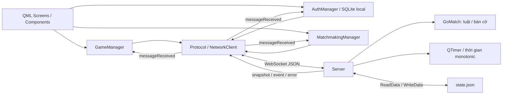
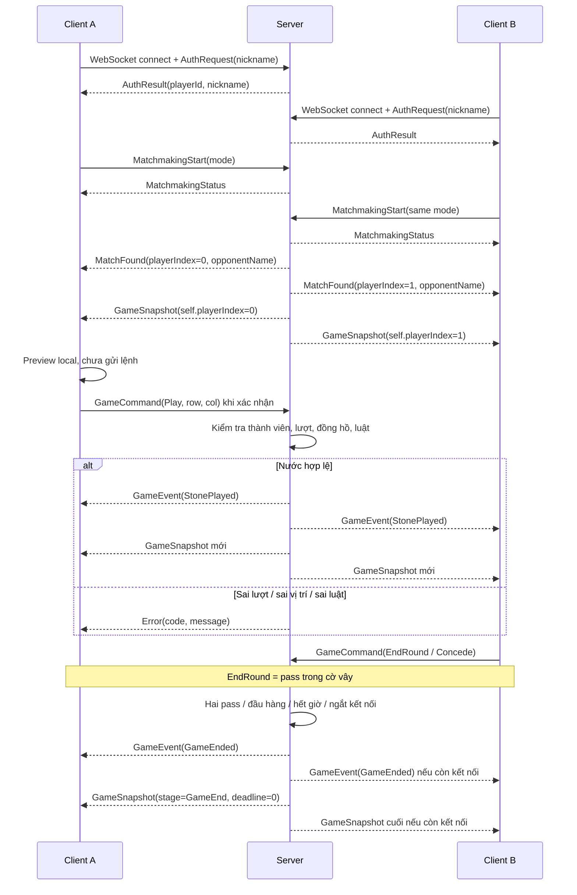

# GoGame

Game cờ vây C++/Qt 6: client Qt Quick/QML và server console WebSocket. Tài liệu được viết lại sau khi review ngày **13/10/2026**. Server đã xử lý ván cờ; client hiện vẫn chơi local, chưa hoàn tất luồng chơi online từ UI.

## Chạy dự án

Cần CMake ≥ 3.16, compiler C++17 cho server và Qt 6 với Core, Gui, Quick/QML, Network, WebSockets, Sql, Multimedia. CMake khai báo Qt ≥ 6.2; client dùng `QWebSocket::errorOccurred`, nên kit Qt phải cung cấp signal này (kit cũ có thể cần điều chỉnh code).

Tại thư mục gốc, mở **terminal riêng cho server**:

```bash
cmake -S server -B build/server
cmake --build build/server --parallel 3
./build/server/appserver --data-file server/data/state.json
```

**Giữ terminal này chạy trong khi dùng client.** Server nghe `ws://127.0.0.1:14509`, dừng bằng `Ctrl+C`. Nếu CMake chưa tìm được Qt, thêm `-DCMAKE_PREFIX_PATH=/duong/dan/toi/Qt` khi configure. File chưa tồn tại được tạo bằng `{}`; file hỏng khiến server dừng và giữ nguyên dữ liệu.

Mở terminal khác cho client:

```bash
cmake -S . -B build/local
cmake --build build/local --parallel 3
GOGAME_SERVER_URL=ws://127.0.0.1:14509 ./build/local/appGoGame
```

Có thể mở `CMakeLists.txt` bằng Qt Creator. Root build cũng thêm target server bằng `add_subdirectory(server)`; không cần chạy thêm server nếu terminal server đã hoạt động. Client tự kết nối khi mở, nhưng `SceneManager.qml` đang mở trực tiếp Board local, bỏ qua màn hình đăng nhập/menu. Chạy hai cửa sổ client **chưa đủ để chơi online** cho tới khi hoàn thành các mục tích hợp bên dưới.

## Kiến trúc và tương tác



Luồng dưới đây là giao thức server đã có và luồng UI cần hoàn thiện. Client đã có lớp transport/managers; thao tác đặt quân/pass từ Board vẫn chạy local.



Server là nguồn quyết định bàn cờ online, lượt và thời gian. Preview chỉ là UI; client cần chờ snapshot sau khi gửi lệnh xác nhận. Luồng `ReadData`/`WriteData` độc lập với trận đấu; hiện không dùng để đồng bộ hoặc tự lưu các match.

## Giao thức JSON và sendSnapshot

Mọi text message dùng envelope `{"type":"...","payload":{...}}`. Binary không được hỗ trợ; giới hạn message nhận 1 MiB.

| Client → server | Payload | Server → client |
| --- | --- | --- |
| `AuthRequest` | `nickname` (1–17 ký tự sau trim) | `AuthResult` với `success`, `playerId`, `nickname`; nickname sai hiện trả `Error`. |
| `MatchmakingStart` | `mode`; `deckId` của template bị bỏ qua | `MatchmakingStatus`, sau đó `MatchFound` và snapshot khi đủ 2 người cùng mode. |
| `MatchmakingCancel` | `{}` | `MatchmakingStatus`. |
| `GameCommand` | `matchId`, `commandType`, `command` | `GameEvent` + snapshot, hoặc `Error`. |
| `ReadData` | `{}` | `Data` chứa `data`. |
| `WriteData` | `data` là JSON object | `DataWritten` với `ok: true`, hoặc `Error`. Thay toàn bộ file. |

Ví dụ đặt quân tại hàng 0, cột 0:

```json
{"type":"GameCommand","payload":{"matchId":"<id từ MatchFound>","commandType":"Play","command":{"row":0,"col":0}}}
```

`Play` yêu cầu tọa độ nguyên 0–18; `EndRound` là pass và `Concede` là đầu hàng, cả hai dùng `command: {}`. Đầu hàng được phép ngoài lượt; đặt quân/pass chỉ được thực hiện đúng lượt. Các lệnh nhân vật, card, skill trong template không được server Go hỗ trợ.

`Server::sendSnapshot(socket, match)` tạo payload riêng cho mỗi người; overload `sendSnapshot(match)` gửi tới cả hai socket. Bàn cờ và thời gian công khai giống nhau, `self.playerIndex` theo người nhận.

| Trường snapshot | Ý nghĩa |
| --- | --- |
| `matchId`, `stage`, `started` | ID trận, `Action` khi chơi hoặc `GameEnd` khi kết thúc. |
| `boardSize`, `board` | 19 và mảng 361 ô theo `row * 19 + col`; `-1` trống, `0` đen, `1` trắng. |
| `moveCount`, `consecutivePasses` | Số lượt đã qua (kể cả pass), số pass liên tiếp. |
| `currentPlayerIndex`, `komi` | Người đến lượt; komi trắng 6,5. |
| `remainingMs` | Mảng thời gian đen/trắng tại lúc snapshot, giữ tương thích payload cũ. |
| `players` | Mỗi người có `playerId`, `nickname`, `playerIndex`, `color`, `remainingTimeMs`. |
| `self.playerIndex` | 0 hoặc 1; không có dữ liệu card/hand riêng. |
| `serverTimeEpochMs` | Thời điểm server tạo snapshot để client ước lượng lệch đồng hồ. |
| `actionDeadlineEpochMs` | Epoch khi **tổng thời gian còn lại của người đang đi** hết; bằng 0 khi trận kết thúc. |
| `winnerIndex`, `endReason` | `-1`/chuỗi rỗng khi đang chơi; người thắng và lý do khi kết thúc. |

Mỗi bên có 600000 ms (10 phút). Server dùng thời gian monotonic để trừ clock và QTimer kiểm tra tối đa mỗi 30 giây; **30 giây không phải giới hạn mỗi nước**. Epoch deadline chỉ phục vụ UI. Snapshot gửi khi ghép trận, sau nước hợp lệ/pass và lúc kết thúc; không phát mỗi giây. Client cần tự animate countdown từ snapshot và hiệu chỉnh khi có snapshot mới. Không có round/weather/replacement/characters/elementPoints/deck/hand vì mô hình hiện tại là cờ vây. Đồng hồ cuối được đóng băng trước khi gửi snapshot kết thúc.

## Kết quả review: đã có và còn thiếu

| Phần | Đã có | Còn thiếu / vấn đề |
| --- | --- | --- |
| Server | Kết nối, guest nickname, hàng chờ theo mode, nhiều match tách bàn cờ, kiểm tra thành viên và lượt. | Mode chưa validate danh sách cho phép; guest chưa xác thực tài khoản thật. |
| Luật | Ăn quân, tự sát, simple ko, pass, đầu hàng, hai pass tính diện tích với komi 6,5. | Superko, thỏa thuận quân chết, kiểm thử sâu các tình huống tính điểm; chưa xem là luật Trung/Nhật hoàn chỉnh. |
| Clock / snapshot | Thời gian server, hết giờ, snapshot từng người, deadline, kết quả cuối. | Bind và hiển thị đồng hồ của mình/đối thủ trong QML. |
| GameManager | Bàn cờ local, preview validation, đặt quân, pass; nhận/store snapshot và phát signal. | `snapshot` chưa có Q_PROPERTY cho QML; snapshot chưa cập nhật `boardState`/`currentPlayer`; Board đặt quân/pass local thay vì gửi `GameCommand`. |
| Board.qml | Grid 19×19, preview hai lần nhấn/nhấp nháy, báo lỗi, flip theo màu, avatar/name panel, background. | Clock còn tham chiếu `root.finished`, `root.me`, `selfPlayer`, `root.gameSecondsLeft` chưa khai báo ở Board; tên/avatar còn hardcode; chưa nối Error server vào thông báo UI. |
| Auth | Client đăng ký/đăng nhập SQLite local, gửi nickname khi login lúc đang kết nối. | Server chỉ guest; reconnect không tự gửi lại AuthRequest. DB thực ở AppDataLocation, không phải file `users.sqlite` ở root. |
| Menu / template | Manager matchmaking gửi/nhận JSON, MatchFound cập nhật match info. | MainMenu còn `deckManager` chưa được cung cấp; card components còn `assetsManager`; một số helper card/character ở Protocol.h chỉ khai báo. |
| Settings / models / AI | Có file và khung tổ chức. | SettingsScreen còn rỗng; Board/UI models và AI còn file rỗng. Preview toggle mới là property, chưa có UI settings/lưu lựa chọn. |
| Lưu dữ liệu | ReadData/WriteData bằng QSaveFile. | Match chỉ ở RAM; không replay, tự lưu match, phục hồi sau restart hay reconnect vào trận. Socket mất kết nối xử thua ngay. ReadData/WriteData hiện không phân quyền. |
| Tài nguyên | Font, 3 background, avatar; AssetManager singleton cho background/font. | Thiếu nhạc, âm thanh đặt quân/báo lỗi; đường dẫn asset card template chưa được giải quyết. |

Ưu tiên tích hợp: expose snapshot cho QML và áp dụng board/lượt → gửi Play/EndRound/Concede từ client online → sửa binding clock và tên người chơi → dọn menu/auth reconnect → lưu trận/replay. Giữ đường chơi local rõ ràng khi tích hợp để không dùng logic local quyết định kết quả online.

## Cấu trúc file hiện tại

Toàn bộ file mã nguồn/tài nguyên và thư mục rỗng hiện có được liệt kê. `.git/`, `.qtcreator/`, `build/` thu gọn vì là dữ liệu Git/IDE hoặc file sinh khi build.

```text
GoGame/
├── .agents/
├── .aws/
├── .codex/
├── .git/ [thu gọn: Git/IDE/file build]
├── .qtcreator/ [thu gọn: Git/IDE/file build]
├── assets/
│   ├── background/
│   │   ├── background1.png
│   │   ├── background2.png
│   │   └── background3.png
│   ├── fonts/
│   │   └── genshin.ttf
│   ├── playerAvatar/
│   │   ├── ayame1.png
│   │   ├── ayame2.png
│   │   ├── ayame3.png
│   │   ├── ayame4.png
│   │   ├── ayame5.png
│   │   ├── ayame6.png
│   │   ├── ayame8.webp
│   │   ├── eula (5).png
│   │   ├── hutao (1).jpeg
│   │   ├── hutao (1).png
│   │   ├── hutao (11).png
│   │   ├── hutao (12).png
│   │   ├── hutao (3).png
│   │   ├── kazuha (3).png
│   │   ├── kazuha (4).png
│   │   ├── kazuha (5).png
│   │   ├── nahida.jpg
│   │   ├── paimon (1).jpg
│   │   ├── yoimiya (1).png
│   │   ├── yoimiya (4).png
│   │   └── yoimiya (8).png
│   ├── sounds/
│   └── stones/
├── build/ [thu gọn: Git/IDE/file build]
├── qml/
│   ├── Components/
│   │   ├── battle/
│   │   │   ├── CountdownClock.qml
│   │   │   ├── ElementPointBar.qml
│   │   │   └── PlayerPanel.qml
│   │   ├── cards/
│   │   │   ├── Card.qml
│   │   │   ├── CharacterCard.qml
│   │   │   └── SupportCard.qml
│   │   ├── common/
│   │   │   ├── Loading.qml
│   │   │   └── Popup.qml
│   │   ├── controls/
│   │   │   ├── GameButton.qml
│   │   │   ├── GameIcon.qml
│   │   │   ├── GameImage.qml
│   │   │   ├── GamePanel.qml
│   │   │   └── GameText.qml
│   │   └── layout/
│   │       ├── GameBackground.qml
│   │       └── GamePanel.qml
│   ├── Core/
│   │   ├── Constants.qml
│   │   ├── Motion.qml
│   │   ├── Radius.qml
│   │   ├── SceneManager.qml
│   │   ├── Spacing.qml
│   │   ├── Theme.qml
│   │   └── Typography.qml
│   ├── Screens/
│   │   ├── Board.qml
│   │   ├── LoginScreen.qml
│   │   ├── MainMenu.qml
│   │   └── SettingsScreen.qml
│   └── Themes/
├── server/
│   ├── data/
│   │   └── state.json
│   ├── test/
│   │   └── Intergration.cpp
│   ├── tests/
│   │   ├── GoCommands.cpp
│   │   └── Integration.cpp
│   ├── CMakeLists.txt
│   ├── GoMatch.cpp
│   ├── GoMatch.h
│   ├── README.md
│   ├── Server.cpp
│   ├── Server.h
│   ├── main.cpp
│   └── main.qml
├── src/
│   ├── Core/
│   │   ├── AI.cpp
│   │   ├── AI.h
│   │   ├── Enums.cpp
│   │   ├── Enums.h
│   │   ├── Enumutils.cpp
│   │   ├── Enumutils.h
│   │   ├── Game.cpp
│   │   └── Game.h
│   ├── Data/
│   ├── Managers/
│   │   ├── AssetManager.cpp
│   │   ├── AssetManager.h
│   │   ├── AuthManager.cpp
│   │   ├── AuthManager.h
│   │   ├── MatchmakingManager.cpp
│   │   └── MatchmakingManager.h
│   ├── Models/
│   │   ├── Board.cpp
│   │   ├── Board.h
│   │   ├── UI.cpp
│   │   └── UI.h
│   └── Network/
│       ├── NetworkClient.cpp
│       ├── NetworkClient.h
│       ├── Protocol.cpp
│       └── Protocol.h
├── .gitignore
├── CMakeLists.txt
├── README.md
├── main.cpp
├── main.qml
└── users.sqlite
```

`server/Server.*` quản lý transport, client, queue, match và clock; `server/GoMatch.*` quản lý luật/bàn cờ. `src/` là phía client. `qml/Core/` chứa scene/theme/token giao diện; `qml/Components/` chứa các component dùng lại. Hai `GamePanel.qml` ở controls và layout hiện cùng tồn tại. `server/test/Intergration.cpp` là bản cũ, không được CMake chạy; test hiện tại ở `server/tests/`. `server/main.qml` cũng là file khung không được server console nạp.

## Kiểm tra

```bash
ctest --test-dir build/server --output-on-failure
```

`goCommands` kiểm tra luật, auth/queue, thành viên, lượt, tọa độ, snapshot theo người nhận, clock/deadline, pass/kết quả và đầu hàng. `serverIntegration` kiểm tra file JSON, WebSocket, restart, message sai và reconnect. Các test dùng localhost cổng 24509/24510 và dữ liệu tạm; không dùng file dữ liệu thật. Có thể tắt test khi configure bằng `-DBUILD_TESTING=OFF`.

Review ngày 13/10/2026: build server sạch ở `build/review-server` thành công, CTest đạt **2/2**. Kết quả build/chạy client sẽ ghi trong nhật ký bên dưới; build thành công không đồng nghĩa chơi online UI đã hoàn thiện.

## Kế hoạch phát triển

### 1. Hoàn thiện Board.qml trước

- [ ] Ưu tiên `qml/Screens/Board.qml`.
- [x] Hoàn thiện UI bàn đấu: ô hiện tên người chơi và avatar.
- [x] Hoàn thành logic đồng hồ đếm ngược phía client.
- [x] Server quản lý thời gian mỗi người chơi và gửi deadline trong snapshot.
- [ ] **Bước tiếp theo: nối snapshot và đồng hồ server vào UI client.**
- [ ] Có thể bổ sung đồng hồ của đối thủ.
- [ ] Cân nhắc thu nhỏ layout bàn cờ để có thêm không gian cho chế độ chơi; đây là ý tưởng có thể làm sau.

### 2. Đặt quân bằng hai lần nhấn

- [x] Lần đầu tại vị trí hợp lệ: chỉ hiện quân cờ mờ, nhấp nháy (preview).
- [x] Lần thứ hai tại cùng vị trí: xác nhận đặt quân.
- [ ] Cho phép bật/tắt chế độ này trong settings.

### 3. Phản hồi khi đặt sai vị trí

- [x] Hiện chữ báo lỗi ở trên cùng màn hình.
- [x] Không cho đặt quân, kể cả preview, ở vị trí không hợp lệ.
- [ ] Phát âm thanh báo lỗi — phần còn thiếu duy nhất của phản hồi vị trí sai.

### 4. Luật Trung / Nhật

- [x] Server có luật cơ bản: ăn quân, tự sát, simple ko, hai lần pass và tính diện tích với komi 6,5.
- [ ] Hoàn thiện luật Trung: superko, xử lý quân chết/thỏa thuận kết quả và kiểm thử tính điểm.
- [ ] Cân nhắc luật Nhật sau vì triển khai phức tạp; chưa ưu tiên.

### 5. Animation khi ăn quân

- [ ] Thêm animation ăn quân ở giai đoạn sau vì khá phức tạp.

### 6. Tài nguyên âm thanh

- [ ] Tìm nhạc game.
- [ ] Tìm âm thanh đặt quân và âm thanh báo lỗi.

### 7. Settings trong trận

- [ ] Cho phép tùy chỉnh âm thanh.
- [ ] Cho phép bật/tắt chế độ preview.

### 8. Settings ngoài trận

- [ ] Đổi giao diện bàn đấu, avatar, khung avatar và danh hiệu.
- [ ] Có tùy chỉnh level và rank theo yêu cầu; cơ chế cụ thể sẽ xác định khi triển khai.
- [ ] Bao gồm mọi tùy chỉnh của settings trong trận.

### 9. Đấu với người qua JSON

- [x] Server gửi JSON snapshot chứa bàn cờ, số nước, lượt và thời gian.
- [ ] Client áp dụng snapshot và gửi lệnh thay cho thay đổi bàn cờ local.
- [ ] Lưu trạng thái trận/replay riêng; hiện trận chỉ nằm trong bộ nhớ, file JSON chưa lưu trận tự động.

### 10. Xem lại ván đấu

- [ ] Lưu tối đa 5 ván gần nhất bằng JSON chứa các nước đã đi.
- [ ] Cho phép xem lại diễn biến ván đấu.
- [ ] Đánh giá nước đi làm sau vì cần AI.

### 11. AI đấu với máy

| Độ khó     | Dự định                                                                               |
| ---------- | ------------------------------------------------------------------------------------- |
| Dễ         | Minimax suy nghĩ nông, tính trước 1–2 nước.                                           |
| Trung bình | Minimax; độ sâu và ngân sách tính toán sẽ xác định khi thử nghiệm.                    |
| Khó        | Alpha-Beta Pruning kết hợp MCTS để tối ưu; hướng tới dùng mạng 6-block ONNX trên CPU. |

- [ ] Đo số phép tính và thời gian trên máy thực tế để mỗi nước AI không tốn quá 1–2 giây.
- [ ] Giới hạn song song tối đa 3 luồng CPU. Ý tưởng ban đầu dùng `ParallelOptions { MaxDegreeOfParallelism = 3 }`; đây là cú pháp C#, khi triển khai trong dự án C++/Qt cần cơ chế tương đương.
- [ ] MCTS giới hạn tối đa 1000 playouts và dừng khi hết ngân sách thời gian.
- [ ] Lớp bảo vệ Alpha-Beta nông ở depth 1 quét các tình huống nguy cấp như Atari, cứu quân; mục tiêu quét khoảng 1 ms cần được đo kiểm.
- [ ] Nếu có nước nguy cấp, trả về nước xử lý ngay; nếu thế trận hòa hoãn, chạy MCTS.
- [ ] Mạng 6-block `.onnx` chạy CPU: policy gợi ý 3–5 nước tốt nhất, value chấm điểm thế trận.

Luồng ý tưởng ban đầu:

```text
[ Người chơi đi 1 nước ]
             |
             v
[ Lớp bảo vệ: Alpha-Beta cắt tỉa nông (Depth 1) ]
[ Quét nhanh: Atari, cứu quân — mục tiêu 1 ms ]
             |
       +-----+--------------------+
       |                          |
Có nước nguy cấp          Thế trận hòa hoãn
       |                          |
       v                          v
[ AI đi luôn ]           [ Bộ não chính: MCTS ]
                         [ Tối đa 3 luồng CPU ]
                         [ Tối đa 1000 playouts ]
                                  |
                                  v
                         [ Mạng 6-block ONNX / CPU ]
                         [ Policy: gợi ý 3–5 nước ]
                         [ Value: chấm điểm thế trận ]
                                  |
                                  v
                         [ Trả về nước đi tối ưu ]
```

“Mát máy, 0% CPU” trong ý tưởng gốc là mong muốn giảm tải khi chọn được nước ngay; xử lý thực tế vẫn sử dụng CPU. Các mốc 1 ms, 1–2 giây, 3 luồng và 1000 playouts là mục tiêu/giới hạn thiết kế cần thử nghiệm, chưa phải kết quả benchmark.

### 12. Build mạng neuron 6b =)))

- [ ] Xây dựng và huấn luyện mạng neuron 6-block.
- [ ] Xuất mô hình `.onnx` để phục vụ policy/value trong AI.
- [ ] Thử nghiệm tốc độ suy luận CPU cùng ngân sách thời gian của MCTS.


## Khai báo AI và nhật ký prompt

README này được soạn với sự hỗ trợ của AI (Codex) theo yêu cầu của chủ dự án. Lần cập nhật này chỉ tạo tài liệu, không triển khai các tính năng trong kế hoạch.

### Phạm vi lịch sử và quy ước cập nhật

Chỉ có prompt liên quan dự án đang hiện diện trong cuộc trò chuyện này để ghi lại. Không có nội dung các prompt ở những phiên trước nên chưa thể khẳng định đây là toàn bộ lịch sử dự án; không suy đoán hoặc tự dựng lại prompt cũ từ mã nguồn.

Theo yêu cầu của chủ dự án, từ đây mỗi lần AI xử lý prompt mới liên quan GoGame phải bổ sung **nguyên nội dung prompt**, ngày và kết quả thực hiện vào mục này, giữ nguyên các mục cũ. Prompt cũ được cung cấp thêm cũng phải được bổ sung, ghi rõ ngày nếu biết. Đây là quy ước cần thực hiện trong các lần làm việc tiếp theo, không phải cơ chế tự động thu thập các cuộc trò chuyện ngoài quyền truy cập.

### 12/10/2026 — Yêu cầu tạo README.md

Nội dung prompt của người dùng (chuẩn hóa khoảng trắng và xuống dòng từ định dạng tin nhắn):

```text
Viết README.md với những yêu cầu sau:

1. Đầy đủ cấu trục file hiện tại
2. Những dự định trong tương lai:
   1. Cần làm phần Board.qml trước, hoàn thiện UI gồm: Phần ô hiện tên người chơi, avatar, đồng hồ đếm ngược,
   2. Đặt quân cần ấn liên tiếp 2 lần, cụ thể ấn lần đầu chỉ hiện quân cờ mờ, nhấp nháy, ấn lần 2 để xác nhận đặt quân. Có thể bật tắt tùy chỉnh này trong settings.
   3. Tại các ô đặt vị trí sai sẽ báo lỗi bằng cách hiện chữ ở trên cùng màn hình, không cho đặt kể cả preview, khoanh đỏ ô đặt lỗi trong 0,5-1 giây(comment lại đoạn này để dễ fix), âm thanh báo lỗi.
   4. Luật Trung/Nhật(có thể sẽ làm nhưng rất phiền nên để làm luật Trung trước.
   5. Animation khi ăn quân (khá phiền nên để sau).
   6. Tìm tài nguyên nhạc game, âm thanh đặt quân.
   7. Trong phần setting trong trận, cho phép tùy chỉnh âm thanh, tắt mở chế độ preview.
   8. Trong phần setting ngoài trận, cho phép đổi giao diện bàn đấu, avatar, khung của avatar, danh hiệu, level, rank. Và mọi setting trong trận.
   9. Chế độ đấu với người hãy thực hiện qua JSON sẽ lưu: sân đấu hiện tại, số bước đã qua, người đi lượt hiện tại, thời gian.
   10. Chế độ xem lại ván đấu: lưu nhiều nhất 5 ván gần nhất lưu json các nước đã đi. Đánh giá nước đi (Tính năng làm sau do cần AI).
   11. AI độ khó của chế độ đấu với máy: Dễ(Suy nghĩ nông tính trước 1-2 nước dùng MinMax, Trung bình dùng MinMax, Khó Alpha-Beta Prune + MCTS để tối ưu (test trước số lượng phép tính cần sao cho các bước không tốn quá 1-2 giây) (giới hạn cpu nếu k cháy máy ParallelOptions { MaxDegreeOfParallelism = 3 }) ý tưởng chính là:

 [ Người chơi đi 1 nước ]
                          │
                          ▼
    [ Lớp Bảo Vệ: Alpha-Beta Cắt Tỉa Nông (Depth 1) ]
    (Quét nhanh 1ms các nước nguy cấp: Atari, Cứu quân)
                          │
            ┌─────────────┴─────────────┐
   Có nước nguy cấp             Thế trận hòa hoãn
            │                           │
            ▼                           ▼
      [ AI ĐI LUÔN ]             [ Bộ não chính: MCTS ]
   (Mát máy, 0% CPU)      ┌─────────────┴─────────────┐
                          │   Khóa cứng: 3 Luồng CPU  │
                          │   Khóa cứng: 1000 Playouts│
                          └─────────────┬─────────────┘
                                        ▼
                    [ Dùng Mạng 6-Block (.onnx) trên CPU ]
                    - Gợi ý 3-5 nước tốt nhất (Policy)
                    - Chấm điểm thế trận lập tức (Value)
                                        │
                                        ▼
                           [ Trả về nước đi tối ưu ]

12. Build cái mạng neuron 6b =)))

3) Khai báo AI: Hãy viết tất cả những gì tôi đã prompt cho bạn của dự án này kể cả hiện tại và sau này vô đây
```

Tài liệu tham khảo: https://www.studocu.vn/vn/document/dai-hoc-dien-luc/dien-luc-university/bao-cao-nhap-mon-tri-tue-nhan-tao/88382780?sid=a353be05-df77-4401-bae7-4597fba4fd601791775595
Kết quả: tạo README.md với cấu trúc hiện tại, đủ 12 mục kế hoạch và nhật ký prompt này. Đối chiếu cây mã nguồn/tài nguyên với hệ thống file; không chạy build hoặc test vì chỉ thay đổi tài liệu.

### 12/10/2026 — Cập nhật README về server và component template

Nội dung prompt của người dùng (chuẩn hóa xuống dòng):

```text
Viết readme.md:

1. Tạo xong server sơ khai, chạy được json
2. Fix 1 số component gây lỗi do template
3. Thêm hướng dẫn sử dụng server như sau: Mở 1 terminal riêg chạy "cmake -S server -B build/server
   cmake --build build/server --parallel 3
   ./build/server/appserver --data-file server/data/state.json" và để yên đó còn lại là client.
4. Cập nhật trạng thái của server: đã có, thiếu những gì.
```

Kết quả: cập nhật README.md hiện có, bổ sung server vào cây thư mục, ghi nhận server JSON sơ khai và các lỗi template đã sửa; thêm hướng dẫn giữ server chạy trong terminal riêng và mở client riêng. Đối chiếu mã server/client để liệt kê phần đã có và còn thiếu, bao gồm tham chiếu `deckManager` còn sót. Lần này chỉ chỉnh tài liệu; không sửa component, không chạy build hoặc test lại.

### 12/10/2026 — Resolve GitHub push conflict

Nội dung prompt của người dùng:

```text
relovse confict of github push
```

Kết quả: hợp nhất `origin/main` vào `main`, giữ lịch sử hai nhánh và sửa conflict trong `server/main.cpp`, `src/Network/NetworkClient.cpp`. Hai phiên bản chỉ khác định dạng khoảng trắng; giữ định dạng local, nhận các thay đổi remote về cấu hình build, tài liệu và test.

Kiểm tra merge: build client `build/Desktop_Debug` và build server sạch `build/merge-check-server` thành công; CTest integration đạt 1/1. Build server trong thư mục cũ gặp cache AUTOMOC lỗi thời; build sạch xác nhận mã hợp nhất hoạt động.

### 12/10/2026 — Implement `gameManager.pass_turn`

Nội dung prompt của người dùng:

```text
implement gameManager.pass_turn
```

Kết quả: thêm `Q_INVOKABLE void Game::pass_turn()` để QML có thể gọi `gameManager.pass_turn()`. Hàm chuyển lượt sang người chơi còn lại, xóa hạn chế ko ngay lập tức vì một lượt bỏ qua đã diễn ra, và phát `currentPlayerChanged` để giao diện cập nhật. Không thay đổi trạng thái bàn cờ. Build client được kiểm tra bằng `cmake --build build/local --parallel 3` và hoàn tất thành công.

### 12/10/2026 — Append AI prompt log to README

Nội dung prompt của người dùng:

```text
and append to the README.md, follow the AI guidelines
```

Kết quả: bổ sung đầy đủ hai prompt của phiên làm việc này, ngày thực hiện và kết quả vào nhật ký AI trong README.md theo quy ước của dự án.

### 12/10/2026 — Cập nhật tiến độ đồng hồ, báo lỗi và layout bàn cờ

Nội dung prompt của người dùng:

```text
Cập nhật README. Đồng thời note những thứ này để sau này tôi làm:

1. Phần đồng hồ đếm ngược đã xong logic nhưng cần handle từ server và có thể thêm đồng hồ của đối thủ -> đã đến bước làm server.
2. Phần báo lỗi vị trí đã xong hết bỏ đi đoạn khoang đỏ đi giờ chỉ thiếu âm thanh báo lỗi.
3. Layout bàn cờ nhỏ hơn(có thể sẽ làm để thêm chế độ chơi).
```

Kết quả: cập nhật tiến độ theo thông tin chủ dự án cung cấp. Đánh dấu logic đồng hồ client đã xong, ghi việc xử lý thời gian ở server là bước tiếp theo và khả năng thêm đồng hồ đối thủ. Đánh dấu phản hồi vị trí sai đã xong, bỏ yêu cầu khoanh đỏ khỏi kế hoạch hiện hành, chỉ giữ âm thanh báo lỗi là việc còn thiếu. Ghi ý tưởng thu nhỏ layout bàn cờ để thêm chế độ chơi. Giữ nguyên prompt lịch sử; chỉ sửa README, không thay đổi mã nguồn hoặc chạy build/test.

### 13/10/2026 — Review toàn dự án, sơ đồ tương tác và sendSnapshot

Nội dung prompt của người dùng (bỏ markup nhấn mạnh, chuẩn hóa khoảng trắng):

```text
Review all project, draw the interaction which will have between server and client. Rewrite readme.md. I sketch the sendSnapshot of server you should complete it: sendSnapshot(socket, match) {
        const localIndex = match.sockets.indexOf(socket);
        this.send(socket, "GameSnapshot", {
            matchId: match.id,
            stage: "Action",
            round: match.round,
            currentPlayerIndex: match.currentPlayerIndex,
            pendingReplacement: match.pendingReplacement || null,
            weather: {
                sequence: match.weather.sequence,
                activeWeather: {
                    type: match.weather.rounds[match.round - 1] ?? "None",
                    startedRound: match.round,
                    remainingRounds: 1,
                },
                roundsPerWeather: 1,
            },
            players: match.players.map((state, index) => {
                const player = this.clients.get(match.sockets[index]);
                return {
                    playerId: player.id,
                    nickname: player.nickname,
                    characters: state.characters.map((character, characterIndex) => ({
                        ...character,
                        element: character.applications[0] ?? "None",
                        active: characterIndex === state.activeCharacterIndex,
                        defeated: character.hp <= 0,
                    })),
                    elementPoints: { current: state.elementPoints, maximum: 10, permanentBonus: 0 },
                    handCardCount: state.hand.length,
                    deckCardCount: state.deck.length,
                    activeCharacterIndex: state.activeCharacterIndex,
                    summons: state.summons.map(publicEffect),
                    states: state.states.filter(item => !item.passive).map(publicEffect),
                    skillAvailability: availability(state, match),
                    switchesUsed: state.switchesUsed || 0,
                    switchesRemaining: Math.max(0, 1 - (state.switchesUsed || 0)),
                    remainingTimeMs: state.remainingMs,
                    endedRound: match.ended.has(index),
                };
            }),
            self: {
                handCardIds: localIndex >= 0 ? match.players[localIndex].hand : [],
                handAvailability: localIndex >= 0 ? handAvailability(match.players[localIndex], match) : [],
            },
            actionDeadlineEpochMs: match.actionDeadlineEpochMs,
        });
    }
```

Kết quả: review kiến trúc client/server, giao thức, luật, clock, auth, matchmaking, QML, tài nguyên, cấu hình build và test; viết lại README với cây file hiện tại, Mermaid kiến trúc/sequence, schema snapshot và các vấn đề tích hợp. Giữ kế hoạch và prompt lịch sử. Hoàn thiện `sendSnapshot(socket, match)` bằng C++ theo mô hình Go hiện có: trạng thái bàn cờ, player identity/color/time, góc nhìn self, stage, thời điểm server/deadline, kết quả cuối; không tạo giả các trường weather/card/character chưa tồn tại. Đóng băng clock lúc kết thúc. Giữ các thay đổi server đang có trong working tree.

Kiểm tra: build server sạch `build/review-server`, CTest đạt 2/2 (`goCommands`, `serverIntegration`); test snapshot mới xác nhận perspective, identities, board metadata, clock/deadline và trạng thái cuối. Build client sạch `build/review-client` thành công; còn cảnh báo Qt policy và file khung rỗng. Kiểm tra runtime offscreen được ghi bổ sung sau khi chạy; chưa kiểm tra thao tác online bằng UI.

Runtime smoke: client offscreen chạy trong 3 giây và bị dừng bằng timeout (exit 124), không có output được ghi nhận; kiểm tra này chưa xác nhận các binding QML hoặc tương tác UI hoạt động. Các vấn đề UI nêu trên được xác định từ review mã nguồn.
