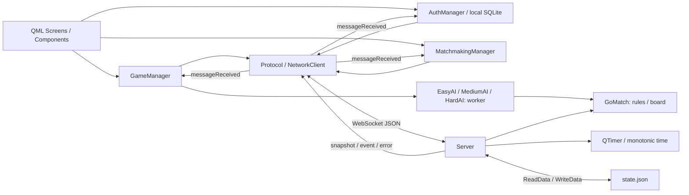
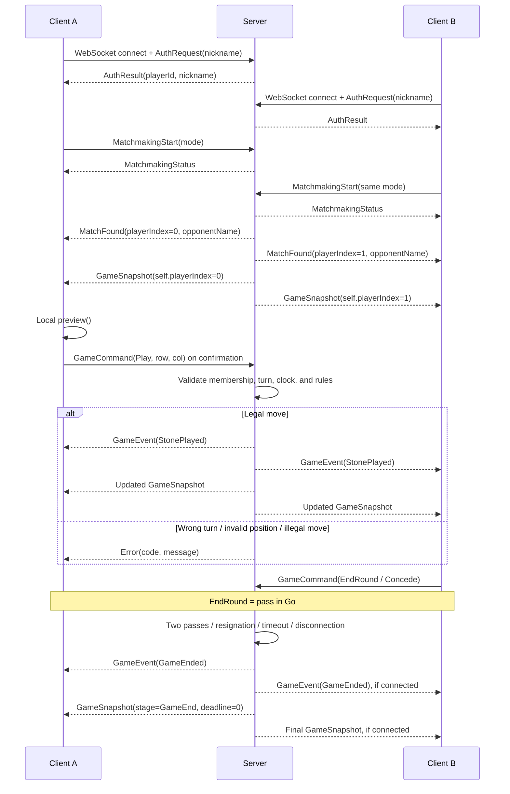

# GoGame Architecture and Protocol

The diagrams and schemas below were moved from the README when the documentation was reorganized. AI currently includes Easy, Medium, and Hard; Hard has an optional KataGo backend. The online diagrams describe the WebSocket flow rather than the complete AI engine. See [README](../README.md) for startup instructions, [SERVER.md](SERVER.md) for protocol details, and [STRUCTUREANDREF.md](STRUCTUREANDREF.md) for the file structure.

## Architecture and Interactions



The following flow is connected through NetworkClient, GameManager, and MatchScreen. Preview stays on the client; only confirmation sends Play. While waiting for a response, the client locks input to prevent duplicate moves.



The server is authoritative for the online board, turns, and time. Preview is a UI feature; the client waits for a snapshot after sending a confirmed command. `ReadData`/`WriteData` is independent of gameplay and does not currently synchronize or automatically save matches.

## JSON Protocol and sendSnapshot

Every text message uses the envelope `{"type":"...","payload":{...}}`. Binary messages are unsupported; incoming messages are limited to 1 MiB.

| Client → server     | Payload                                     | Server → client                                                                                         |
| ------------------- | ------------------------------------------- | ------------------------------------------------------------------------------------------------------- |
| `AuthRequest`       | `nickname` (1–17 characters after trimming) | `AuthResult` with `success`, `playerId`, and `nickname`; an invalid nickname currently returns `Error`. |
| `MatchmakingStart`  | `mode` (1–64 characters after trimming)     | `MatchmakingStatus`, then `MatchFound` and a snapshot when two players select the same mode.            |
| `MatchmakingCancel` | `{}`                                        | `MatchmakingStatus`.                                                                                    |
| `GameCommand`       | `matchId`, `commandType`, `command`         | `GameEvent` and a snapshot, or `Error`.                                                                 |
| `ReadData`          | `{}`                                        | `Data` containing `data`.                                                                               |
| `WriteData`         | `data` as a JSON object                     | `DataWritten` with `ok: true`, or `Error`. Replaces the entire file.                                    |

Example: place a stone at row 0, column 0:

```json
{
    "type": "GameCommand",
    "payload": { "matchId": "<id from MatchFound>", "commandType": "Play", "command": { "row": 0, "col": 0 } }
}
```

`Play` requires integer coordinates from 0 to 18. `EndRound` means pass and `Concede` means resignation; both use `command: {}`. Resignation is allowed outside the player's turn; placing a stone or passing requires the correct turn. The Go server does not support character, card, or skill commands from the template.

`Server::sendSnapshot(socket, match)` creates a recipient-specific payload; the `sendSnapshot(match)` overload sends to both sockets. Public board and clock data are identical, while `self.playerIndex` identifies the recipient.

| Snapshot field                   | Meaning                                                                                                                       |
| -------------------------------- | ----------------------------------------------------------------------------------------------------------------------------- |
| `matchId`, `stage`, `started`    | Match ID; `Action` during play or `GameEnd` after completion.                                                                 |
| `boardSize`, `board`             | 19 and an array of 361 cells indexed by `row * 19 + col`; `-1` empty, `0` Black, `1` White.                                   |
| `moveCount`, `consecutivePasses` | Number of turns, including passes, and consecutive passes.                                                                    |
| `currentPlayerIndex`, `komi`     | Player to move; White receives 6.5 komi.                                                                                      |
| `remainingMs`                    | Black/White time until the current boundary: main time or one Byo-yomi period.                                                |
| `clocks`                         | Each player's `mainRemainingMs`, `periodRemainingMs`, `periodDurationMs`, `periodsRemaining`, and `phase` (`Main`/`ByoYomi`). |
| `players`                        | Each player's `playerId`, `nickname`, `playerIndex`, `color`, and `remainingTimeMs`.                                          |
| `self.playerIndex`               | 0 or 1; no private card/hand data.                                                                                            |
| `serverTimeEpochMs`              | Snapshot creation time, used by the client to estimate clock offset.                                                          |
| `actionDeadlineEpochMs`          | Epoch of the active player's current main-time/period boundary; 0 after the match ends.                                       |
| `winnerIndex`, `endReason`       | `-1`/empty string during play; winner and reason after completion.                                                            |

Each player receives **10 or 15 minutes of main time plus 3 × 20-second Byo-yomi periods**. Exhausting main time starts Byo-yomi; exhausting a period consumes one period. A legal move or pass resets the current period to 20 seconds without restoring consumed periods; invalid commands do not reset time. Exhausting the final period loses the game. The server uses monotonic time and QTimer checks at a boundary or at most every 30 seconds; 30 seconds is not a per-move limit. Snapshots are sent on matching, legal moves, timer updates, and game completion. GameClock interpolates both players' clocks between snapshots. The payload stage remains a string; no card-game/stage enum is required on the client.
