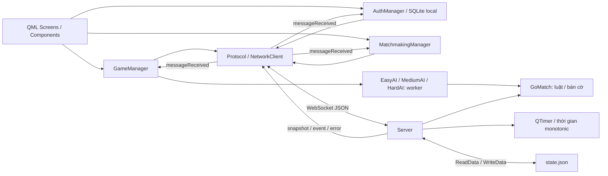
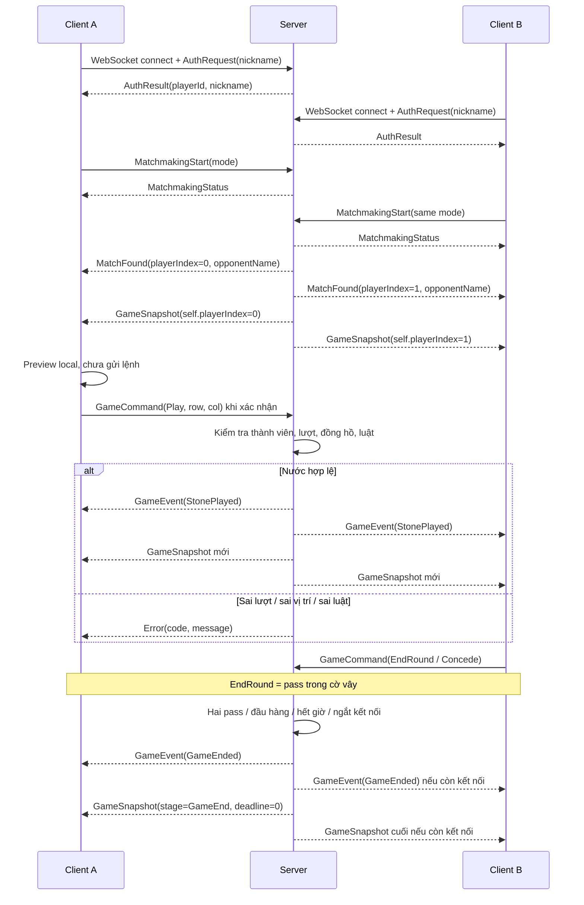

# Kiến trúc và giao thức GoGame

Các sơ đồ/schema dưới đây chuyển từ README trước khi tách. AI hiện có Easy, Medium và Hard; Hard có backend KataGo tùy chọn. Sơ đồ online mô tả luồng WebSocket, không mô tả toàn bộ engine AI. Hướng dẫn chạy ở [README](../README.md); giao thức chi tiết tại [SERVER.md](SERVER.md); cấu trúc file tại [STRUCTUREANDREF.md](STRUCTUREANDREF.md).

## Kiến trúc và tương tác



Luồng dưới đây đã được nối qua NetworkClient, GameManager và MatchScreen. Preview giữ ở client; chỉ lần xác nhận mới gửi Play. Khi chờ phản hồi, client khóa thao tác để tránh gửi nước trùng.



Server là nguồn quyết định bàn cờ online, lượt và thời gian. Preview chỉ là UI; client cần chờ snapshot sau khi gửi lệnh xác nhận. Luồng `ReadData`/`WriteData` độc lập với trận đấu; hiện không dùng để đồng bộ hoặc tự lưu các match.

## Giao thức JSON và sendSnapshot

Mọi text message dùng envelope `{"type":"...","payload":{...}}`. Binary không được hỗ trợ; giới hạn message nhận 1 MiB.

| Client → server     | Payload                             | Server → client                                                                    |
| ------------------- | ----------------------------------- | ---------------------------------------------------------------------------------- |
| `AuthRequest`       | `nickname` (1–17 ký tự sau trim)    | `AuthResult` với `success`, `playerId`, `nickname`; nickname sai hiện trả `Error`. |
| `MatchmakingStart`  | `mode` (1–64 ký tự sau trim)        | `MatchmakingStatus`, sau đó `MatchFound` và snapshot khi đủ 2 người cùng mode.     |
| `MatchmakingCancel` | `{}`                                | `MatchmakingStatus`.                                                               |
| `GameCommand`       | `matchId`, `commandType`, `command` | `GameEvent` + snapshot, hoặc `Error`.                                              |
| `ReadData`          | `{}`                                | `Data` chứa `data`.                                                                |
| `WriteData`         | `data` là JSON object               | `DataWritten` với `ok: true`, hoặc `Error`. Thay toàn bộ file.                     |

Ví dụ đặt quân tại hàng 0, cột 0:

```json
{
    "type": "GameCommand",
    "payload": { "matchId": "<id từ MatchFound>", "commandType": "Play", "command": { "row": 0, "col": 0 } }
}
```

`Play` yêu cầu tọa độ nguyên 0–18; `EndRound` là pass và `Concede` là đầu hàng, cả hai dùng `command: {}`. Đầu hàng được phép ngoài lượt; đặt quân/pass chỉ được thực hiện đúng lượt. Các lệnh nhân vật, card, skill trong template không được server Go hỗ trợ.

`Server::sendSnapshot(socket, match)` tạo payload riêng cho mỗi người; overload `sendSnapshot(match)` gửi tới cả hai socket. Bàn cờ và thời gian công khai giống nhau, `self.playerIndex` theo người nhận.

| Trường snapshot                  | Ý nghĩa                                                                                                                  |
| -------------------------------- | ------------------------------------------------------------------------------------------------------------------------ |
| `matchId`, `stage`, `started`    | ID trận, `Action` khi chơi hoặc `GameEnd` khi kết thúc.                                                                  |
| `boardSize`, `board`             | 19 và mảng 361 ô theo `row * 19 + col`; `-1` trống, `0` đen, `1` trắng.                                                  |
| `moveCount`, `consecutivePasses` | Số lượt đã qua (kể cả pass), số pass liên tiếp.                                                                          |
| `currentPlayerIndex`, `komi`     | Người đến lượt; komi trắng 6,5.                                                                                          |
| `remainingMs`                    | Mảng thời gian đen/trắng tới ranh giới thời gian hiện tại (main hoặc một period Byo-yomi).                               |
| `clocks`                         | Mỗi người có `mainRemainingMs`, `periodRemainingMs`, `periodDurationMs`, `periodsRemaining`, `phase` (`Main`/`ByoYomi`). |
| `players`                        | Mỗi người có `playerId`, `nickname`, `playerIndex`, `color`, `remainingTimeMs`.                                          |
| `self.playerIndex`               | 0 hoặc 1; không có dữ liệu card/hand riêng.                                                                              |
| `serverTimeEpochMs`              | Thời điểm server tạo snapshot để client ước lượng lệch đồng hồ.                                                          |
| `actionDeadlineEpochMs`          | Epoch của ranh giới main/period hiện tại của người đang đi; bằng 0 khi trận kết thúc.                                    |
| `winnerIndex`, `endReason`       | `-1`/chuỗi rỗng khi đang chơi; người thắng và lý do khi kết thúc.                                                        |

Mỗi bên có **10 hoặc 15 phút chính + 3 lần Byo-yomi × 20 giây**. Hết main time chuyển sang Byo-yomi; hết một period mất một lần. Nước đi/pass hợp lệ hồi period hiện tại về 20 giây, không hồi số lần đã mất; lệnh sai không hồi giờ. Hết lần cuối xử thua. Server dùng monotonic time và QTimer kiểm tra tại ranh giới hoặc tối đa mỗi 30 giây; 30 giây không phải giới hạn mỗi nước. Snapshot gửi khi ghép trận, sau nước hợp lệ, timer và lúc kết thúc. GameClock nội suy clock của mình và đối thủ giữa các snapshot. Trường stage vẫn là chuỗi trong payload; không cần enum stage/card-game ở client.

